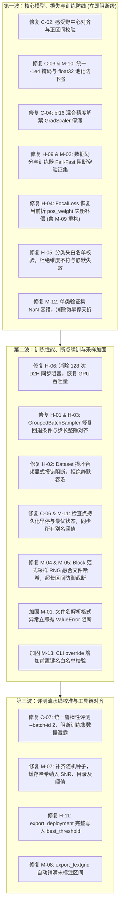

# WavFry 代码库核心缺陷深度复核报告（精简聚焦版）

- **报告日期**：2026-09-07
- **复核总原则**：**学术研究务实标准**。以科学严谨性、实验结果有效性、数值稳定性、可复现性及 Fail-Fast 防御为唯一评判准则。
- **梳理与再审定说明**：
  经对原始审计条目的全面技术复核与再审定：
  1. **坚决剔除 16 项企业安全假警与脱离声学常识的过度设计**（包括 C-01, C-05, H-07, H-08, H-10, H-12, H-13, H-14, H-15, M-03, M-06, L-01, L-03~L-05）；
  2. **加回并确认 23 项必须修复的核心缺陷**：
     - **M-04 与 M-05** 正式加回：跨文件采样伪相关与超长区间异常属于数据与范式层真实隐患，必须完成代码修复；
     - **H-02** 重新定性为 **Fail-Fast 刚性防御项**：损坏音频静默替换 `idx+1` 虽无标签错位，但吞没异常严重违背 Fail-Fast，必须改为抛出明确异常；
     - **H-03** 正式加回：锚点槽位双重整除截断导致抽样预算与随机池需求脱节，3 行代码即可彻底对齐；
     - **M-11** 正式加回：跨卷回退为 `shutil.copy` 后导致 `best_ep*.pt` 别名缺失最优阈值，需进行同步写入；
     - **M-09**（FocalLoss 双重 sigmoid）本身数值稳定，并入 **H-04**（FocalLoss 支持 pos_weight）一并重构。
  3. **所有条目的原始编号保持不变**，便于对照追溯。

---

## 剔除条目最终裁决清单（共 16 项不再列入整改）

| 原始编号 | 剔除原因与裁决依据 |
| :--- | :--- |
| **C-01** (`torch.load` weights_only=False) | **安全过度设防**：离线单机科研实验，权重为本机训练产出；PyTorch 2.6 下开启会导致断点保存的 NumPy RNG 状态反序列化崩溃。 |
| **C-05** (`delta checkpoint` 冻结层丢失) | **机制误解**：代码实例化时直接加载微软官方预训练权重，且配有自包含导出脚本；仅无网无缓存新机器有拉取边缘场景。 |
| **H-07** (余弦调度 warmup 首步 lr=0) | **机制偏好 / 规范误解**：符合 Hugging Face LambdaLR 教科书规范，大步数下影响微弱，无需过度纠结。 |
| **H-08** (`total_steps` 固化与早停冲突) | **教条化理论偏见**：模型训练以验证集最优（最低 val loss / 最高 PR-AUC）早停为最高仲裁准则，无需强求走满退火曲线。 |
| **H-10** (加噪峰值归一化量化噪声) | **脱离声学现实**：线性 SNR 严格不变；16-bit PCM 动态范围高达 96dB，-20dB SNR 下语音仍在量化底噪上 64dB 且被环境白噪声完全掩蔽；归一化系防整型削波刚需。 |
| **H-12** (YAML 硬编码本机盘符) | **过度工程化**：科研人员跨机器迁移时按需修改配置文件即可，引入复杂相对路径或环境变量纯属过度设计。 |
| **H-13** (`--override` 模型骨干供应链投毒) | **威胁模型错配**：本地研究人员拥有整机最高权限，命令行覆盖骨干是消融实验标配，不存在多租户云端提权攻击面。 |
| **H-14** (`file_key` 路径遍历) | **威胁模型错配**：标注库来源可信且受正则校验，非外部 Web 用户上传攻击，不构成 CWE-22 漏洞。 |
| **H-15** (Checkpoint 配置内网路径与声纹 PII) | **威胁模型错配**：Checkpoint 存完整超参是可复现性金标准；TensorBoard 听音是语音诊断刚需，语料合法授权非隐私泄漏。 |
| **M-03** (静默片段加噪 scale≈0 学到捷径) | **任务本质误判**：本任务是区分“嘎裂元音 vs 常态元音”（均有能量），非语音静音检测；clamp(1e-4) 反而会在自然静音中注入假噪声。 |
| **M-06** (预处理低通滤波割裂) | **非活动风险**：全配置中低通滤波均已全局关闭（`enabled: false`），全链路代码休眠；仅外部 GUI 预测工具统一 30ms padding 即可。 |
| **M-09** (`FocalLoss` 双重 sigmoid 非稳定) | **并入 H-04**：数值本身稳定，重构 H-04 支持 `pos_weight` 时一并精简代码，不再作为独立项。 |
| **L-01** (`build_manifest.py` 输出路径硬编码) | **低优先级**：增加参数虽好但对学术结果无实质影响，按需直接覆盖即可。 |
| **L-03** (`freeze_layers` 未 strip 空格) | **低优先级**：数值解析自带 strip，仅特殊单数字情况，属于微小代码容错。 |
| **L-04** (`__init__.py` 空模块) | **符合行业规范**：深度学习工程中保持子包 `__init__.py` 简练以避免隐式全量加载重型模型，是标准防死锁实践。 |
| **L-05** (`pyproject.toml` 依赖未 pin hash) | **规范误解**：PEP 621 规定 pyproject.toml 声明抽象依赖，项目已有 135KB 的 `uv.lock` 完整锁定 SHA-256 哈希。 |

---

# 第一部分：保留的 Critical 级别核心缺陷（共 5 项）

| 编号 | 审计项标题 | 代码位置 | 核心学术危害与机理 |
| :--- | :--- | :--- | :--- |
| **C-02** | 区间帧掩码误用 `_get_feat_extract_output_lengths` | `wavfry/model/wavlm_classifier.py:150-154` | 误用序列总长度降采样公式映射起止时刻。30~50ms 短元音产生 1~2 帧（20~40ms）系统性左移偏移，误差达 50%~100%；越界区间强制取末帧脏标签。 |
| **C-03** | `logmeanexp_pool` 在 AMP/fp16 下溢出崩溃 | `wavfry/model/losses.py:34-38` | `masked_fill` 使用 `finfo(float16).min = -65504`，温度系数乘法或 logsumexp 内部下溢为 `-inf`，导致梯度计算出现 $(-\infty)-(-\infty)=\mathbf{NaN}$ 毁灭性崩溃。 |
| **C-04** | `bf16` 混合精度下错误启用 `GradScaler` | `wavfry/train/trainer.py:58-61, 300`<br>`config/_defaults.yaml:69` | `bf16` 具备 fp32 同等动态范围，启用 scaler 会引发错误的梯度缩放及步进跳过（`skip_lr_sched=True`），导致学习率调度器停滞。 |
| **C-06** | 断点续训丢失早停计数与历史最佳指标 | `wavfry/train/trainer.py:74-78, 618-632, 703-728` | `latest.pt` 未持久化 `patience_counter` 与 `best_primary_metric_val`。续训后最佳指标重置为 0.0，首轮必定强行覆盖 `best_model.pt` 并物理删除真正历史最佳权重。 |
| **C-07** | 鲁棒性测试集生成与评估脚本 `batch_id` 错位 | `scripts/generate_noisy_testset.py:52`<br>`scripts/evaluate_setup_b_noise.py:970` | 噪声测试集基于 Batch 2（验证集）生成，评估脚本默认 `--batch-id 1`（训练集），导致评测直接在训练集上运行，已在缓存中取证到真实的数据泄露（Train-set Leakage）。 |

---

### C-02 深度技术分析与修复代码
- **定位**：`wavfry/model/wavlm_classifier.py:150-154`
- **机理**：WavLM 前端卷积总步长为 320 点（20ms），感受野 400 点（25ms）。函数 $N(L) = \lfloor (L - 400)/320 \rfloor + 1$ 仅表达整段音频降采样后的总帧数。直接作用于区间起止点导致提取窗口向更早时刻系统性偏移 $12.5\sim 20\text{ ms}$（典型 30ms 元音被漏选 50% 核心帧，混入前导辅音帧）。空区间被强行绑定末尾 padding 帧带标签反向传播。
- **修复代码**：
```python
def _interval_frame_masks(
    self,
    interval_bounds: torch.Tensor,
    slot_valid: torch.Tensor,
    lengths: torch.Tensor,
    frame_count: int,
) -> torch.Tensor:
    conv_stride = 320
    audio_lengths = lengths.unsqueeze(1)
    start_samples = interval_bounds[..., 0].clamp_min(0)
    start_samples = torch.minimum(start_samples, audio_lengths)
    end_samples = interval_bounds[..., 1].clamp_min(0)
    end_samples = torch.minimum(end_samples, audio_lengths)

    is_positive = end_samples > start_samples
    start_frames = (start_samples // conv_stride).clamp(min=0, max=frame_count)
    end_frames = ((end_samples + conv_stride - 1) // conv_stride).clamp(min=0, max=frame_count)
    end_frames = torch.where(
        is_positive & (end_frames <= start_frames),
        (start_frames + 1).clamp(max=frame_count),
        end_frames
    )

    frame_positions = torch.arange(frame_count, device=interval_bounds.device).view(1, 1, -1)
    return (
        slot_valid.unsqueeze(-1)
        & is_positive.unsqueeze(-1)
        & (frame_positions >= start_frames.unsqueeze(-1))
        & (frame_positions < end_frames.unsqueeze(-1))
    )
```

---

### C-03 深度技术分析与修复代码
- **定位**：`wavfry/model/losses.py:34-38`
- **机理**：`finfo(float16).min = -65504`，当乘以温度系数（如 $T=2.0$）时乘积变为 `-131008`，在半精度浮点数下直接溢出为 `-inf`。在反向传播计算梯度时产生 `NaN`，瞬间击溃模型权重。且与模型其他池化分支使用的 `-1e4` 割裂。
- **修复代码**：
```python
def logmeanexp_pool(logits: torch.Tensor, mask: torch.Tensor, temperature: float = 1.0) -> torch.Tensor:
    if temperature <= 0:
        raise ValueError("temperature must be positive")
    orig_dtype = logits.dtype
    logits_fp32 = logits.float()
    masked = logits_fp32.masked_fill(~mask, -1e4)
    count = mask.sum(dim=-1).clamp_min(1).float()
    pooled = (
        torch.logsumexp(masked * temperature, dim=-1) - count.log()
    ) / temperature
    return pooled.to(dtype=orig_dtype)
```

---

### C-04 深度技术分析与修复代码
- **定位**：`wavfry/train/trainer.py:58-61, 300`
- **机理**：`bfloat16` 原生具有 8 位指数位（动态范围高达 $\sim 10^{38}$，与 `float32` 完全同级），PyTorch 官方规范明确规定其不需要也不应当启用 `GradScaler`。代码无条件初始化 scaler，导致在 `bf16` 下不定期触发错误的跳步判定（`skip_lr_sched=True`），使优化器与学习率调度停滞。
- **修复代码**：
```python
self.use_amp = self.mixed_prec in ('fp16', 'bf16') and 'cuda' in str(device)
self.scaler = torch.amp.GradScaler('cuda') if (self.use_amp and self.mixed_prec == 'fp16') else None
```

---

### C-06 深度技术分析与修复代码
- **定位**：`wavfry/train/trainer.py:74-78, 618-632, 703-728`
- **机理**：检查点未保存 `patience_counter`、`best_primary_metric_val` 与 `best_threshold`。`--resume` 后最佳指标重置为 0.0，若断点发生在模型收敛后过拟合阶段（如 Epoch 20，`auc_pr = 0.74`，而 Epoch 5 曾达到 0.92），第 21 轮由于 `0.74 > 0.0` 恒成立，错误判定为全局最优，直接用劣质权重覆盖 `best_model.pt`，并触发清理逻辑将磁盘上真实的全局最佳检查点物理删除。
- **修复代码**：
```python
# save_checkpoint 补充字段:
checkpoint['patience_counter'] = self.patience_counter
checkpoint['best_primary_metric_val'] = self.best_primary_metric_val
checkpoint['best_threshold'] = getattr(self, 'best_threshold', 0.5)

# load_checkpoint 恢复与对齐:
self.patience_counter = checkpoint.get('patience_counter', 0)
self.best_primary_metric_val = checkpoint.get('best_primary_metric_val', 0.0)
self.best_threshold = checkpoint.get('best_threshold', 0.5)
```

---

### C-07 深度技术分析与修复方案
- **定位**：`scripts/generate_noisy_testset.py:52`, `scripts/evaluate_setup_b_noise.py:970`
- **机理与证据**：加噪与混响生成脚本硬编码 `batch_id == 2`（验证集），而评估脚本默认 `--batch-id 1`（训练集）。在 `02_en_mfa_aligned/_creaky_cache` 下已确凿发现历史运行产生的 `batch_1_SNR10` 缓存，证实历史评估直接在训练集上测过噪声鲁棒性，造成严重的训练集数据泄露（Train-set Leakage）。
- **修复方案**：
  1. 将所有 `evaluate_setup_b_*.py` 脚本的默认 `--batch-id` 纠正为 `2`；
  2. 在评估入口增加断言强拦截：
     ```python
     if target_batch_split == "train":
         raise ValueError(f"[DATA LEAKAGE ERROR] Batch [{args.batch_id}] is marked as 'train'! Cannot evaluate robustness on training data.")
     ```
  3. 彻底清理加噪音频目录中属于 Batch 1 的残留文件及历史脏缓存，重新基于纯净的 Batch 2 评估并更新曲线。

---

# 第二部分：保留的 High 级别核心缺陷（共 8 项）

| 编号 | 审计项标题 | 代码位置 | 核心学术危害与机理 |
| :--- | :--- | :--- | :--- |
| **H-01** | `GroupedBatchSampler` 随机池回退至全量，污染锚点隔离 | `wavfry/data/grouped_sampler.py:82-87` | 误将“累加抽样总次数”与“独立样本数”对比，导致非锚点池频繁误判不足而回退至包含锚点发音人的全集，破坏批次内 1:1 对比约束并引入批内重复样本。 |
| **H-02** | `CreakyVowelDataset` 损坏音频静默吞没异常，违背 Fail-Fast | `wavfry/data/dataset.py:131-133` | 音频损坏或缺失时静默调用 `__getitem__(idx+1)` 吞没异常继续运行。科研数据若有破损必须立即报错阻断，严禁静默容错；同时破坏批次内采样器预定槽位。 |
| **H-03** | 锚点槽位双重整除截断，抽样预算与随机池需求脱节 | `wavfry/data/grouped_sampler.py:46-51, 118` | `// 2 // 2` 导致实抽锚点数强制为 4 的倍数（如预算 6~7 个实抽仅 4 个），且 `needed_random` 依赖的名义槽位与实抽产生差额，结构随机漂移。 |
| **H-04** | `FocalLoss` 静默丢弃 `pos_weight`（并重构数值计算） | `wavfry/model/losses.py:68`<br>`wavfry/train/trainer.py:54` | 训练器精准统计并传入了当前折 7:1 至 15:1 的正负样本不平衡比，但 FocalLoss 内部直接丢弃该参数，硬编码使用固定 3.0 倍权重，少数类（嘎裂音）梯度被严重压制 3~5 倍。 |
| **H-05** | 分类头维度依赖子串匹配，`pooling_mode` 拼写即崩溃或静默失效 | `wavfry/model/wavlm_classifier.py:41` | 初始化用子串判断，前向用严格相等判断。变体命名导致前向穿透维度不对齐抛 `RuntimeError` 崩溃；拼写错误（如 `mean_top_k`）静默回退至普通 mean 池化，消融实验静默作废。 |
| **H-06** | Python循环池化 + `item()` 同步阻塞，每 step 128 次 D2H | `wavlm_classifier.py:130, 180`<br>`trainer.py:261` | Block 模式下外层循环执行 `bool(effective_valid[b, s])`，强转 CPU bool 导致每步触发 128 次 CUDA D2H 同步阻塞，GPU 计算流水线频繁停顿，吞吐量暴跌 50%~70%。 |
| **H-09** | 默认 `val_speakers=[sampled]` 致验证空集，`validate:357` 早停绕过 | `config/_defaults.yaml:19`<br>`trainer.py:357, 443`<br>`scripts/train.py:46` | 数据集缺少相应字段时验证集为空（0 行）。训练器静默放行跳过验证，全盲跑满 30 轮且无法产出 `best_model.pt`。**必须贯彻 Fail-Fast 立即抛出 ValueError 阻断退出，绝不静默放行！** |
| **H-11** | `export_deployment.py` 丢失 `best_threshold`，部署回退 0.5 | `scripts/export_deployment.py:77-84` | 导出自包含权重包时遗漏 `best_threshold`，下游推理脚本静默降级为默认阈值 0.5，丢失后处理阈值网格搜索带来的性能收益（少数类 F1 衰退 1%~5%）。 |

---

### H-01 深度技术分析与修复代码
- **定位**：`wavfry/data/grouped_sampler.py:82-87, 146-155`
- **机理**：`needed_random = self.total_batches * self.random_slots` 代表整轮的抽样频次累加值，而 `sampled_indices` 是当前可用的非锚点独立样本列表。代码错误地判断 `if len(sampled_indices) < needed_random:`，使得一旦样本数少于该乘积就全量回退为 `list(range(len(self.df)))`。由于后续代码已有耗尽重新洗牌机制，此处的过度回退直接导致锚点说话人被随机槽随意抽中，彻底破坏批次内说话人对比约束。
- **修复代码**：
```python
# 仅当非锚点样本真正为空集合时才发出警告并回退
if len(sampled_indices) == 0:
    logger.warning("No non-anchor samples available. Falling back to full dataset for random pool.")
    self.random_pool_base = list(range(len(self.df)))
else:
    self.random_pool_base = list(sampled_indices)
```

---

### H-02 深度技术分析与 Fail-Fast 修复代码
- **定位**：`wavfry/data/dataset.py:131-133`
- **机理再辨析**：
  原审计所称“音频与标签错位”不实（递归重新读取了 `idx+1` 的完整 row，音频与标签自洽）；
  **但是，该处的真正高危学术缺陷是“静默吞没异常（Silent Fallback）”**：
  1. 在严谨科研语料库中，若音频文件损坏、解码异常或路径丢失，代码捕获 `Exception` 后直接递归请求下一条样本，实质上静默放行了脏数据；
  2. 在 `GroupedBatchSampler` 调度下，采样器分配 `idx` 本意是抽取指定发音人的特定类别样本（如锚点发音人正样本），静默替换为 `idx+1` 会破坏批内预定槽位分布。
- **Fail-Fast 刚性拦截代码**：
```python
except Exception as e:
    raise RuntimeError(
        f"[DATASET FATAL ERROR] Failed to load audio sample at index {idx} "
        f"(path: '{audio_path}'): {e}. Academic training refuses silent fallback!"
    ) from e
```

---

### H-03 深度技术分析与修复代码
- **定位**：`wavfry/data/grouped_sampler.py:46-51, 118`
- **机理**：
  名义预算由 `round(batch_size * n_anchor / total)` 算得。但实抽时：
  `slots_per_speaker = self.anchor_slots // self.anchor_speakers_per_batch`
  `slots_per_label = slots_per_speaker // 2`
  实际抽取的锚点样本总数严格为：`anchor_speakers_per_batch * 2 * slots_per_label`。
  当计算得出 `anchor_slots = 6` 或 `7` 时，实际实抽永远被向下整除截断为 `4`；而被丢弃的 2~3 个槽位由随机样本顶替，导致 `self.random_slots` 账面预算与实际消耗产生脱节。
- **修复代码**：
```python
# 按步长（anchor_speakers_per_batch * 2）直接对齐圆整，消除名义与实抽偏差
step = max(1, self.anchor_speakers_per_batch * 2)
slots_per_label = max(1, computed_slots // step)
self.anchor_slots = min(slots_per_label * step, self.batch_size)
self.random_slots = self.batch_size - self.anchor_slots
```

---

### H-04 深度技术分析与修复代码（包含 M-09 重构）
- **定位**：`wavfry/model/losses.py:68-79`, `wavfry/train/trainer.py:54-55`
- **机理**：在语音嘎裂音检测中，嘎裂音属于高稀缺性的发音特征，正负比例通常在 1:7 至 1:15。训练器通过 `pos_weight = n_neg / (n_pos + 1e-9)` 进行了精确动态统计，但 `FocalLoss` 初始化根本不接收 `pos_weight`，直接使用固定的 `alpha=0.75`（权重比仅 3.0 倍），导致少数类正样本损失权重被大幅削弱，召回率与 PR-AUC 被严重压低。同时重构移除冗余双重计算。
- **修复代码**：
```python
class FocalLoss(nn.Module):
    def __init__(self, alpha: float = 0.75, gamma: float = 2.0, pos_weight: float | torch.Tensor | None = None):
        super().__init__()
        self.alpha = alpha
        self.gamma = gamma
        if pos_weight is not None:
            if not isinstance(pos_weight, torch.Tensor):
                pos_weight = torch.tensor(pos_weight, dtype=torch.float32)
            self.register_buffer("pos_weight", pos_weight)
        else:
            self.pos_weight = None

    def forward(self, inputs: torch.Tensor, targets: torch.Tensor) -> torch.Tensor:
        bce_loss = F.binary_cross_entropy_with_logits(
            inputs, targets, pos_weight=self.pos_weight, reduction="none"
        )
        p = torch.sigmoid(inputs)
        p_t = p * targets + (1 - p) * (1 - targets)
        loss = bce_loss * ((1 - p_t) ** self.gamma)
        if self.alpha >= 0:
            alpha_t = self.alpha * targets + (1 - self.alpha) * (1 - targets)
            loss = alpha_t * loss
        return loss.mean()
```

---

### H-05 深度技术分析与修复代码
- **定位**：`wavfry/model/wavlm_classifier.py:33, 41-43, 108-128`
- **机理**：初始化时通过 `"mean" in s and ("topk" in s or "attn" in s)` 进行松散的子串推断，前向池化却采用严格匹配。若参数命名为 `mean_top_k`，分类头被初始化为 1536 维，但池化函数未命中任何分支而穿透返回 768 维，直接引发形状不匹配的 `RuntimeError`；若拼写错误未命中任何分支，代码静默回退至均值池化，研究人员浑然不觉消融实验已经失效。
- **修复代码**：
```python
SUPPORTED_POOLING_MODES = {
    "mean": 1,
    "mean_topk": 2,
    "mean_attn": 2,
    "attn": 1,
}

if self.pooling_mode not in SUPPORTED_POOLING_MODES:
    raise ValueError(
        f"Unsupported pooling_mode: '{self.pooling_mode}'. "
        f"Supported modes: {list(SUPPORTED_POOLING_MODES.keys())}"
    )
self.pool_multiplier = SUPPORTED_POOLING_MODES[self.pooling_mode]
in_features = self.hidden_dim * self.pool_multiplier
```

---

### H-06 深度技术分析与修复方案
- **定位**：`wavlm_classifier.py:126, 190-198`, `trainer.py:259-264`
- **机理**：在 Block 模式下（$16 \times 8 = 128$ 个 slot），`trainer.py:261` 在外层 Python 循环中执行 `if bool(effective_valid[b, s]):`。由于 `effective_valid` 驻留在 GPU 显存中，强转 Python `bool` 强制 CPU 挂起等待 GPU 并在 PCIe 上执行同步 D2H 传输，单步触发 128 次串行同步；叠加 Python 循环逐槽发射微型 Kernel，导致 GPU 利用率暴跌至 30%。
- **修复方案**：
  1. 在 `trainer.py` 循环前一次性将掩码拉取至 CPU：`valid_cpu = effective_valid.detach().cpu().numpy()`；
  2. 模型前向池化改用批处理掩码与广播矩阵乘法，彻底消除外层 Python 循环调用。

---

### H-09 深度技术分析与 Fail-Fast 修复代码
- **定位**：`config/_defaults.yaml:19`, `wavfry/train/trainer.py:357-358, 443`, `scripts/train.py:46, 159`
- **机理**：默认配置 `val_speakers: [sampled]`。当语料缺少相应字段时，验证集划分出 0 行。训练器错误地将其判定为“无需验证”，设置 `has_val = False` 并静默放行，导致模型盲跑 30 个轮次且无法产生最优检查点。
- **Fail-Fast 刚性拦截代码（绝不静默放行）**：
```python
# 1. scripts/train.py:46 切分后立即强校验阻断
if len(val_df) == 0:
    raise ValueError(
        f"[DATA SPLIT ERROR] Validation dataset is empty (0 rows)! "
        f"Configured 'data.val_speakers' ({val_speakers}) matched zero samples. "
        f"Training without validation is strictly forbidden in academic evaluation."
    )

# 2. wavfry/train/trainer.py: 彻底删除 trainer.py:358 伪造 0.0 字典与 has_val 跳过旁路
if val_loader is None or len(val_loader) == 0:
    raise RuntimeError("Trainer requires a non-empty validation DataLoader. Cannot train blindly.")
```

---

### H-11 深度技术分析与修复方案
- **定位**：`scripts/export_deployment.py:77-84`
- **机理**：训练器经 PR 曲线后验搜索得到最优判定阈值 `best_threshold`，但在导出自包含部署包时未将其打包至 `full_checkpoint` 中。下游推理脚本 `predict.py` 读取不到该字段，静默回退至硬编码默认值 0.5，导致少数类 F1 严重衰退 1%~5%。
- **修复方案**：
  在打包字典中显式加入 `'best_threshold': ckpt.get('best_threshold', 0.5)`，并同步覆写配置字典中的 `config['inference']['threshold']`。

---

# 第三部分：保留的 Medium 级别核心缺陷（共 10 项）

| 编号 | 审计项标题 | 代码位置 | 核心学术危害与机理 |
| :--- | :--- | :--- | :--- |
| **M-01** | `_language_from_file_key` 格式漂移静默丢弃音频 | `wavfry/data/manifest.py:81, 192` | 文件名若未严格遵循第 4 段为语言代码的格式，函数返回 `None` 并在构建清单时静默 `continue` 跳过，导致发音人标注数据被无声无息剔除。**必须严格 Fail-Fast 抛出 ValueError 阻断退出！** |
| **M-02** | `make_batch_split` 缺 `batch_split` 列静默全训练 | `wavfry/data/splits.py:76-80` | 缺少切分列时仅打印一行警告，静默返回空验证集并触发全训练，与 H-09 恶性联动。**必须 Fail-Fast 抛出 KeyError 阻断退出！** |
| **M-04** | `BlockIndex` RNG 仅由 `start_s` 决定，跨文件伪相关 | `wavfry/data/paradigm_block.py:93` | 随机种子丢弃了 `file_key`。不同音频在相同起始时间戳（如 0.0s）获得完全相同的伪随机偏移量，破坏独立同分布并产生跨发音人伪相关。 |
| **M-05** | 超长区间 > 2s 直接 `ValueError` 崩溃 | `wavfry/data/paradigm_block.py:121` | 固定 2 秒块范式下，若对话语料中出现大于 2 秒的长元音或拖长停顿，直接在 DataLoader 中抛异常导致整机训练崩溃。 |
| **M-07** | 噪声/RIR 注入无 seed、缓存无 SNR/threshold 哈希 | `scripts/generate_noisy_testset.py:28`<br>`scripts/evaluate_setup_b_noise.py:512` | 加噪与混响无固定随机种子；评测缓存仅哈希发音人文件名，严重缺失 SNR、音频目录及决策阈值变量，换参后静默复用脏缓存。 |
| **M-08** | `export_textgrid.py` 区间未铺满生成非法 TextGrid | `scripts/export_textgrid.py:27-44` | Praat 官方规范要求 `IntervalTier` 必须无缝密铺 $[x_{\min}, x_{\max}]$。原脚本仅写元音留出空隙，导致 Praat GUI 与 praatio 拒绝加载崩溃。 |
| **M-10** | `pool_frame_logits` 掩码常数 -1e4 与 finfo.min 不统一 | `wavfry/model/losses.py:34-38, 54-65` | 与 C-03 深度耦合。`max` 与 `top_k_mean` 使用 `-1e4`，而 `lse` 误用 `finfo.min` 在半精度下引发下溢 NaN，同一模块内部规范严重撕裂。 |
| **M-11** | Checkpoint 跨盘 `os.link` 回退 `copy` 后阈值写回脱节 | `wavfry/train/trainer.py:586, 668` | 跨卷使用 `shutil.copy` 产生独立文件，后续 `_update_checkpoint_threshold` 仅写回 `best_model.pt`，导致 `best_ep*.pt` 归档检查点中永久丢失最优阈值。 |
| **M-12** | 单类验证集 `auc_pr` 捕获为 0.0 污染早停 | `wavfry/train/metrics.py:17-21`<br>`wavfry/train/trainer.py:74, 474-486` | LOOCV 留一发音人交叉验证中，若某验证说话人完全未发嘎裂音，PR-AUC 异常捕获后强行赋 0.0。因 `0.0 > 0.0` 为假，`best_model.pt` 永不保存，连续 3 轮触发伪早停夭折。 |
| **M-13** | `--override` 无白名单/校验，拼写错误静默失效 | `scripts/train.py:220-250` | 动态递归创建字典键。若研究人员手滑输错参数名（如 `traning.lr`），静默插入无用孤立键，训练仍沿用默认超参，消融实验静默失败。 |

---

### M-01 深度技术分析与 Fail-Fast 修复代码
- **定位**：`wavfry/data/manifest.py:81, 192`
- **机理**：死板假定文件名必定包含第 4 段语言标识。一旦遇到不符合预期的命名，返回 `None` 并在循环中静默 `continue` 丢弃。
- **Fail-Fast 刚性拦截代码（绝不隐式回退，绝不静默跳过）**：
```python
lang = _language_from_file_key(file_key)
if lang is None:
    raise ValueError(
        f"[MANIFEST FORMAT ERROR] Audio file key '{file_key}' does not match the "
        f"expected convention (e.g. 'Gender_Age_Dialect_Language_SpeakerID_...'). "
        f"Cannot determine language token at index 3. Please correct filename or update parser."
    )
```

---

### M-02 深度技术分析与 Fail-Fast 修复代码
- **定位**：`wavfry/data/splits.py:76-80`
- **机理**：缺失列时仅打印 Warning，返回空验证集并导致下游全盲训练。
- **Fail-Fast 刚性拦截代码**：
```python
if 'batch_split' not in df.columns:
    raise KeyError(
        "[DATA SPLIT ERROR] Required partition column 'batch_split' not found in dataframe! "
        "Refusing silent fallback to all-train mode."
    )
```

---

### M-04 深度技术分析与修复代码
- **定位**：`wavfry/data/paradigm_block.py:93`
- **机理**：在 Block 范式下，对长非嘎裂音区间进行负采样截断时，伪随机数种子 `rng = random.Random(int(start_s * 1000) + fold_index)` 完全未吸纳 `file_key`。句首（如 0.0s、0.5s）区间获得完全相同的随机扰动偏移量，破坏了跨说话人样本的独立同分布特性。
- **修复代码**：
```python
import hashlib
file_hash = int(hashlib.md5(file_key.encode('utf-8')).hexdigest()[:8], 16)
rng = random.Random(file_hash + int(start_s * 1000) + fold_index)
```

---

### M-05 深度技术分析与修复代码
- **定位**：`wavfry/data/paradigm_block.py:121`
- **机理**：Block 范式设定固定上下文时长为 2.0 秒。原代码 `if duration > self.duration_s: raise ValueError(...)` 直接崩溃退出。虽然当前数据集中最大区间仅 1.91 秒且目前主线使用 segment 范式，但作为通用长音频分块切片组件，应具备防御性截断或跳过能力。
- **修复代码**：
```python
if interval_duration > self.duration_s:
    logger.warning(
        f"Interval {primary} duration ({interval_duration:.3f}s) exceeds block capacity ({self.duration_s}s). "
        f"Truncating to {self.duration_s}s."
    )
    end = start + self.duration_s
```

---

### M-07 深度技术分析与修复方案
- **定位**：`scripts/generate_noisy_testset.py:28`, `scripts/evaluate_setup_b_noise.py:512, 575`
- **机理**：生成脚本未设置固定随机种子；评估脚本缓存哈希仅哈希发音人列表，完全没有纳入当前评估的 SNR 等级与算法阈值变量，导致调整信噪比后直接静默读取历史脏缓存。
- **修复方案**：
  1. 生成脚本入口显式调用 `torch.manual_seed(42)` 与 `np.random.seed(42)`；
  2. 评测缓存哈希完整融入评测目录名、SNR 及模型阈值：
     ```python
     hash_payload = f"{model_name}|{audio_dir.name}|SNR_{snr}|thresh_{threshold:.4f}|{'|'.join(sorted(file_keys))}"
     cache_hash = hashlib.md5(hash_payload.encode('utf-8')).hexdigest()
     ```

---

### M-08 深度技术分析与修复代码
- **定位**：`scripts/export_textgrid.py:27-44`
- **机理**：Praat 规范要求 `IntervalTier` 必须无缝密铺。未填补非元音区间导致导出的 TextGrid 存在时间空隙，Praat 弹窗报错并拒绝加载文件。
- **修复代码**：
```python
filled_tier = new_tier.get_copy_with_gaps_filled(
    start_time=0.0,
    end_time=tg.end_time,
    empty_string=""
)
tg.add_tier(filled_tier)
```

---

### M-10 深度技术分析与修复方案
- **定位**：`wavfry/model/losses.py:34-38, 54-65`
- **机理**：同一模块内掩码策略割裂。与 C-03 深度耦合，直接导致 AMP 下溢。
- **修复方案**：统一将损失函数与模型池化中所有无效帧掩码填充值固定为常数 `-1e4`，并在执行 log-sum-exp 算子前统一转 `float32`。

---

### M-11 深度技术分析与修复代码
- **定位**：`wavfry/train/trainer.py:586, 668`
- **机理**：
  在非 NTFS 分区或跨卷场景下，`os.link` 抛出异常并回退至 `shutil.copy`，使得 `best_model.pt` 成为脱钩的独立文件。后续 `_update_checkpoint_threshold` 仅打开并写回了 `best_model.pt`，导致磁盘上按 epoch 命名的 `best_ep*.pt` 归档文件中永久缺失了最优阈值字段。
- **修复代码**：
```python
def _update_checkpoint_threshold(self, best_threshold: float, threshold_f1: float):
    # 同步更新 best_model.pt 以及当前 fold 下所有符合命名规则的 best_ep*.pt
    targets = [self.ckpt_dir / "best_model.pt"]
    val_speakers = self.config['data']['val_speakers']
    val_str = "_".join(val_speakers) if isinstance(val_speakers, list) else str(val_speakers)
    targets.extend(list(self.ckpt_dir.glob(f"best_ep*_{val_str}.pt")))
    
    updated_count = 0
    for ckpt_path in set(targets):
        if not ckpt_path.exists():
            continue
        try:
            ckpt = torch.load(ckpt_path, map_location='cpu', weights_only=False)
            ckpt['best_threshold'] = best_threshold
            ckpt['threshold_f1'] = threshold_f1
            if 'metrics' in ckpt:
                ckpt['metrics']['best_threshold'] = best_threshold
                ckpt['metrics']['threshold_f1'] = threshold_f1
            # 原子写入防损坏
            tmp = ckpt_path.with_suffix('.pt.tmp')
            torch.save(ckpt, tmp)
            os.replace(tmp, ckpt_path)
            updated_count += 1
        except Exception as exc:
            logger.warning(f"Failed to inject threshold into {ckpt_path}: {exc}")
    logger.info(f"Synchronized optimal threshold {best_threshold:.3f} across {updated_count} checkpoints.")
```

---

### M-12 深度技术分析与修复代码
- **定位**：`wavfry/train/metrics.py:17-21`, `wavfry/train/trainer.py:74, 474-486`
- **机理**：LOOCV 单类说话人验证折下，PR-AUC 异常捕获后强行返回 0.0。初始最佳值亦为 0.0，`0.0 > 0.0` 为假，`best_model.pt` 无法生成；且早停计数器每轮自增，连续 3 轮后触发伪早停熔断，整折训练夭折。
- **修复代码**：
```python
# metrics.py: 单类异常时返回 NaN
except ValueError:
    auc_pr = float('nan')

# trainer.py: 检测到 NaN 时冻结早停计数器自增，或降级以 val_loss 判定
if math.isnan(primary_val):
    logger.warning(f"Epoch {epoch}: Primary metric is NaN (single-class validation fold). Freezing early stopping counter.")
else:
    if primary_val > self.best_primary_metric_val:
        self.best_primary_metric_val = primary_val
        self.patience_counter = 0
        is_best = True
    else:
        self.patience_counter += 1
```

---

### M-13 深度技术分析与 Fail-Fast 修复代码
- **定位**：`scripts/train.py:220-250`
- **机理**：CLI `--override` 缺乏键名合法性校验，拼写错误静默插入孤立键，消融实验静默失败。
- **Fail-Fast 刚性校验代码**：
```python
def validate_override_key(cfg_dict, key_path):
    parts = key_path.split('.')
    cur = cfg_dict
    for p in parts:
        if p not in cur:
            raise KeyError(
                f"[CONFIG OVERRIDE ERROR] Invalid configuration key '{key_path}'! "
                f"Segment '{p}' does not exist in base configuration. Check for typos."
            )
        cur = cur[p]
```

---

# 第四部分：核心 23 项落地整改路线图（三波推进）

聚焦保留的 23 项关键缺陷，按影响范围与依赖层级划分为三波推进落地：



---

# 第五部分：全库 Fail-Fast 刚性阻断规范看板

针对学术科研场景下“**若有问题必须明确报错退出，严禁静默降级或吞没异常**”的刚性准则，全库核心阻断清单汇总如下：

| 类别 | 涉及条目与位置 | 原静默反模式行为 | 学术隐患 | Fail-Fast 刚性整改要求 |
| :--- | :--- | :--- | :--- | :--- |
| **数据切分防线** | **H-09** (`train.py:46`)<br>**M-02** (`splits.py:76`) | 切分列缺失仅打印 Warning；验证集 0 行时训练器设置 `has_val=False` 静默跳过验证跑满 30 轮 | 浪费全部算力，不跑早停，永不保存最优模型，产出空检查点 | **立即阻断**：缺列抛 `KeyError`；验证集 0 行立即抛 `ValueError` 中断退出；训练器禁止空验证集实例化，彻底移除伪造 0.0 字典逻辑。 |
| **数据加载防线** | **H-02** (`dataset.py:131`) | 音频解码失败仅打 print，递归取 `idx+1` 继续 | 脏数据/文件丢失被静默放行掩盖，且扰乱批内预定采样分布 | **立即阻断**：音频损坏或丢失直接抛出 `RuntimeError` 终止，通知实验者修复语料文件。 |
| **超参消融防线** | **M-13** (`train.py:220`)<br>**H-05** (`wavlm_classifier.py:128`) | 命令行参数拼写错误静默插入孤立键；池化模式拼写错误穿透后静默回退均值池化 | 实际训练仍沿用默认超参，消融实验静默作废，结论失真 | **立即阻断**：覆盖前按白名单校验键路径，不存在则抛 `KeyError`；池化模式未命中白名单抛 `ValueError`。 |
| **断点续训防线** | **C-06** (`trainer.py:703`)<br>新增隐患 **S-01** (`train.py:195`) | 用户显式指定 `--resume` 时加载检查点失败仅打 Warning，随后静默从第 1 轮从头重新训练 | 覆盖历史进度，若前序已有部分断点，会静默重跑并冲垮旧检查点 | **立即阻断**：显式指定 `--resume` 加载失败必须抛 `RuntimeError` 立即停止，严禁静默从头训；持久化并校验已有模型指标。 |
| **评测流水线防线** | **C-07** (`evaluate_setup_b_*.py`)<br>**M-07** (`evaluate_setup_b_noise.py:512`) | 评测脚本默认跑训练集；缓存哈希未纳入 SNR 与阈值，改参后静默复用脏缓存 | 数据泄露严重破坏论文可信度；测试报告混入干净语音旧预测 | **前置阻断与哈希加固**：评估集被标记为 `train` 直接抛异常拦截；缓存 Key 必须严格包含 `audio_dir`、`snr` 及模型决策阈值变量。 |
| **数据入库防线** | **M-01** (`manifest.py:192`) | 文件名格式不符合预期时，`language = None`，在循环中静默 `continue` 丢弃音频 | 整个发音人的合法标注数据被无声无息剔除出训练集 | **立即阻断**：保持既有发音人命名解析规范；文件名不符合格式直接抛出 `ValueError` 阻断退出，通知实验者排查，严禁静默丢弃。 |

---
*完整审计报告已精简收敛并归档于：`E:\\Corpus\\CS-Dialogue\\data\\short_wav\\WAVE\\06_wavfry\\docs\\audit_report_20260907.md`*
