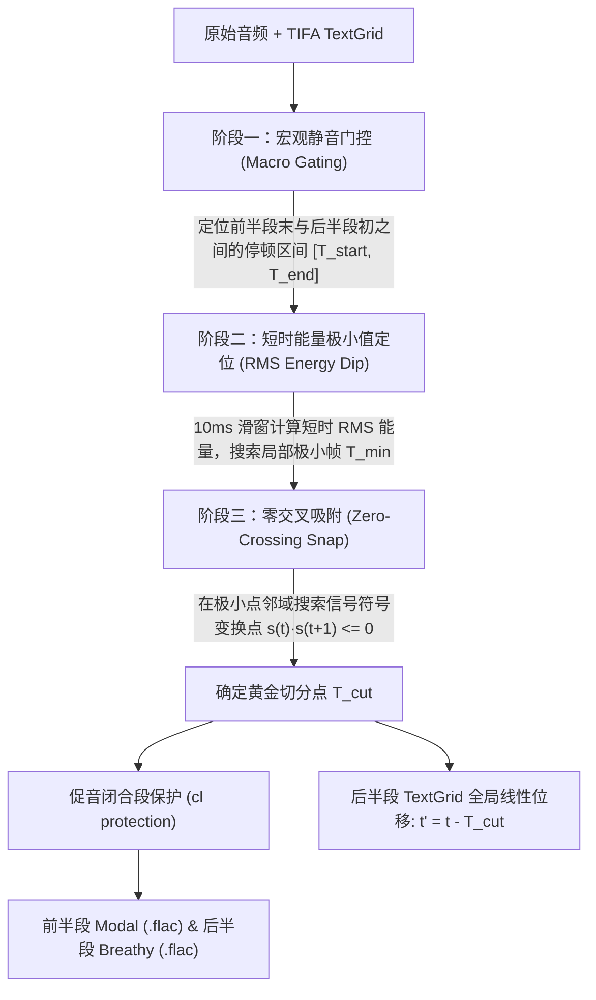

# BreathyTTS: 基于 Gemini 3.8 Flash TTS 的日语副语言气声合成与标注方法论

> **文档定位**：本文档详细记录了构建 **BreathyTTS**（日语副语言气声数据集）的理论基础、剧本生成、端到端语音合成、音素强制对齐、无爆音声学切分、基准真值标注投影，以及在对抗性常态（Modal）合成探索中的关键科学发现。供后续撰写学术论文（Methodology / Dataset Construction / Experiments & Discussion 章节）直接参考使用。

---

## 1. 语音学背景与研究动机 (Theoretical & Phonetic Foundations)

### 1.1 发声态物理机理：气声（Breathy Voice）vs. 常态（Modal）vs. 耳语（Whisper）
在语音发声态（Phonation / Voice Quality）连续体中：
* **常态音（Modal Voice）**：声带在发音周期内实现完全的闭合与规律的周期性振动，声门阻抗正常，谐波丰富，能量集中于基频及低次谐波，高频气流噪声极低；
* **气声（Breathy Voice / Murmur）**：**声带软骨部（杓状软骨）保持一定开度，同时膜部声带维持周期性振动**。其核心声学特征是**基频周期振动与持续的声门湍流漏气（Voiced Aspiration）共存**；
* **耳语（Whisper）**：声带完全不振动（无基频，无 Voicing），声门间隙仅产生纯无声摩擦气流（Unvoiced Friction）。

### 1.2 现实语料稀缺性与副语言功能
气声在日语日常对话中承载着至关重要的**副语言（Paralinguistic）与情感语用功能**（如表达秘密、真情吐露、叹息、放松、自嘲或爱想笑）。然而，真实对话中气声具有高度瞬态性与稀缺性，且极难人工标注。为此，本项目利用大模型受控合成管线构建大规模高质量副语言气声语音库。

### 1.3 Carlos T. Ishi (ATR) 日语副语言气声分类学
本项目严格遵循日本 ATR 语音学者 Carlos T. Ishi 建立的对话气声分类体系（涵盖 **8 个大分类、18 个子分类**），覆盖 540 个独立对话场景：

| 大分类 (Macro Category) | 子分类 ID (`sub_id`) | 子分类名称与典型情境 | 推荐标签 |
| :--- | :--- | :--- | :--- |
| **1. 強調・注意喚起・真情吐露** | `emphasis_attention` | 強調・注意の促し（引起对方注意的重要焦点） | `<breath>` |
| | `real_feelings` | 真の気持ち・本音（「本当に」「実は」心底吐露） | `<breath>` |
| **2. 興奮・感情再現引用** | `excited_speech` | 興奮気味の発話（事态紧急、热火朝天的临场感） | `<breath>` |
| | `quoting_excited` | 興奮した発言の再現引用（模仿当时别人激动的口气） | `<breath>` |
| **3. 丁寧・改まった相槌** | `formal_politeness` | 改まった丁寧・謙虚（深思熟虑、郑重恭敬的相槌） | `<sigh>` |
| | `casual_interest` | 親密な関心・共感相槌（倾听倾诉时的深切共鸣） | `<breath>` |
| **4. 童話の読み聞かせ・優しさ**| `gentle_narrative` | 穏やかな語りかけ・情景描写（温暖安详的讲述） | `<breath>` |
| **5. 驚き・意外・感心** | `unexpectedness` | 驚き・意外（意料之外倒吸一口凉气的反应） | `<gasp>` |
| | `admiration` | 感心・感嘆（面对美景或赞叹由衷发出的感叹） | `<breath>` |
| **6. ひそひそ話・戸惑い・独り言**| `confidential` | 内緒話・言えない事（隔墙有耳的悄悄话、秘密） | `<breath>` |
| | `embarrassment` | 戸惑い・困惑（语塞、害羞、难为情的搪塞） | `<sigh>` |
| | `talking_to_oneself`| 自己発話・独り言（整理思绪自言自语） | `<breath>` |
| **7. ため息混じりの発話** | `weariness` | 疲れ・疲労（下班脱力沉重的叹息） | `<sigh>` |
| | `disappointment` | 残念・がっかり（落空沮丧的叹息） | `<sigh>` |
| | `relief` | 安心・安堵（卸下重担松了一口气） | `<sigh>` |
| **8. 笑いが伴う発話** | `funny` | 面白い・可笑しさ（忍不住笑意的对话） | `<laugh>` |
| | `bitter` | 苦笑い・自嘲（无可奈何的自嘲苦笑） | `<laugh>` |
| | `forced` | 愛想笑い・社交辞令（职场防尴尬的客套笑声） | `<laugh>` |

---

## 2. 剧本池生成与多样性控制 (Script Generation Protocol)

核心实现脚本：[`scripts/gemini_tts_synthesis/script_generator.py`](file:///E:/Corpus/CS-Dialogue/data/short_wav/WAVE/06_wavfry/scripts/gemini_tts_synthesis/script_generator.py)

### 2.1 架构设计与 Fail-Fast 原则
* **文本生成模型**：本地严格隔离的 LLM 端口（8045 端口，`gemini-3.8-flash-high`），禁止向公网无感回退；
* **两段式逻辑结构**：
  * **前半段（`modal_text`，30%~40%）**：正常常态发音（Modal Voice），用于构建基线声学特征；
  * **后半段（`breathy_text`，60%~70%）**：感情注入与副语言核心段，强制注入气声提示词与发声标签（如 `<breath>`）；
  * **停顿间隙**：要求人物 B 在前后半句间包含自然的换气节点或心理转折，为后续声学切分留出声学窗口。

### 2.2 解除模版绑定的动态随机种子机制
为了防止 LLM 局限于 Carlos T. Ishi 的原始范例词汇（如反复出现“カロリー”、“ラーメン”等食物话题），剧本生成器实施了**动态随机种子机制**：
1. 每次请求动态生成 6 位随机整数 `seed_val = random.randint(100000, 999999)`；
2. 在 Prompt 尾部追加显式标记 `[seed: {seed_val}]`，并在 API 请求体中透传 `seed`；
3. 系统 Prompt 明确要求模型自由发散话题（职场、人际、爱好、意外、生活杂感），每个子类保证 30 个完全不同人际关系和剧本背景的对话（$18 \times 30 = 540$ 条）。

### 2.3 文本校验与自愈重试
每个生成的剧本经过 `validate_script_data` 校验（字数要求平假名换算 35~110 字，约 5~15 秒；排查非法特殊字符；严格断言 clean 文本字符拼接一致性），不合规自动触发 4 次自愈重试，并以原子文件（Atomic Write）落盘至 `script_pool_cache/`。

---

## 3. 端到端语音合成架构 (Speech Synthesis Pipeline)

核心实现脚本：[`scripts/gemini_tts_synthesis/run_smoke_test.py`](file:///E:/Corpus/CS-Dialogue/data/short_wav/WAVE/06_wavfry/scripts/gemini_tts_synthesis/run_smoke_test.py)、[`tts_client.py`](file:///E:/Corpus/CS-Dialogue/data/short_wav/WAVE/06_wavfry/scripts/gemini_tts_synthesis/tts_client.py)

### 3.1 说话人音色注册表（Universal Voice Registry）
为了保证声学模型训练具有充分的说话人解耦能力（Speaker Disentanglement），管线注册了 **30 个 Gemini 官方预置音色**（映射至 `U0001` ~ `U0030`）：
* 男女比例严格平衡（15 名男性、15 名女性）；
* 音色特征覆盖青年、壮年、沉稳低音、清亮高音、新闻朗读与日常对话；
* 540 条剧本与 30 位说话人以 Round-Robin 轮询严格绑定，每位说话人配发恰好 18 条发话。

### 3.2 多段分格 Style 组装与全局 Director Instructions
通过 OpenRouter 的 `/audio/speech` 端点输入时，管线构建了高灵敏度的分段引导指令：
```python
parts = [
    {
        "text": script["modal_text"],
        "speech_metadata": {"speaker": voice_name, "style": script["modal_style"]},
    },
    {
        "text": script["breathy_text_with_tag"],
        "speech_metadata": {"speaker": voice_name, "style": script["breathy_style"]},
    },
]
instructions = (
    f"Section 1 ({modal_text}): {modal_style}. "
    f"Section 2 ({breathy_text}): {breathy_style}. "
    "CRITICAL: Maintain distinct pitch contour and periodic vocal fold vibration; strictly do NOT produce unvoiced whisper."
)
```
* **正向引导**：Section 2 注入 `"voiced breathy tone, continuous vocal cord vibration with distinct pitch contour, sighing breath leakage"`；
* **负向硬约束**：显式禁止纯耳语（`strictly do NOT produce unvoiced whisper`），强迫模型维持声带基频周期振动。

### 3.3 并发调度、容灾与财务审计
* **多线程并发**：采用 `ThreadPoolExecutor`，支持 4~8 线程并发请求；
* **毫秒级断点续跑（Idempotent Resumption）**：Stage 1 检查 `raw_dialogues/*.wav` 文件存在且大小正常（>4KB），直接 0ms 跳过，绝不重复扣费；
* **三级财务账单追踪**：
  * 单条级别：查询 OpenRouter `generation_id`，记录 `tokens_prompt`、`tokens_completion` 和 `cost_usd` 写入 `synthesis_metadata.csv`；
  * Session 级别：每次运行落盘 `token_usage_sessions.jsonl`；
  * 累计级别：维护 `token_usage_summary.json`，核算平均单条音频成本仅约 **$0.0031 美元**（约合人民币 2 分钱/条）。

---

## 4. 强制对齐与三阶段无爆音切分算法 (Alignment & Slicing Mechanics)

核心实现脚本：[`scripts/gemini_tts_synthesis/tifa_align_wrapper.py`](file:///E:/Corpus/CS-Dialogue/data/short_wav/WAVE/06_wavfry/scripts/gemini_tts_synthesis/tifa_align_wrapper.py)、[`audio_dialogue_slicer.py`](file:///E:/Corpus/CS-Dialogue/data/short_wav/WAVE/06_wavfry/scripts/gemini_tts_synthesis/audio_dialogue_slicer.py)

### 4.1 TIFA 批量音素对齐
* 采用基于 PyTorch 的 **TIFA（Torch-based Japanese Forced Aligner）**；
* 批量流水线优化：一次性将深度学习模型驻留 GPU 显存，避免对每条音频重复加载模型（对齐速度由单条 5s 降低至批处理 0.3s/条）；
* 输出高精度音标层（`phones`）与词层（`words`）未切分 TextGrid。

### 4.2 三阶段无爆音智能切分（Three-Stage Pop-Free Slicing）
若直接按固定时间戳裁剪音频，波形不连续会产生严重的数字爆音（Click/Pop artifact），破坏高频频谱并干扰气声检测。切分器实施了精密的物理声学吸附算法：



1. **阶段一（宏观门控）**：通过 TextGrid 音素层定位 `modal_text` 最后一个音素结束与 `breathy_text` 第一个音素开始之间的物理停顿窗口（通常为 0.3~1.2s 的呼吸/静音间隔）；
2. **阶段二（短时能量极小点）**：以 10ms 滑窗计算窗内 RMS 能量，寻找能量绝对洼地，避免切在残余混响或呼吸气流的高能量区；
3. **阶段三（零交叉吸附）**：向波形符号反转点（$s(n) \cdot s(n+1) \le 0$ 且 $|s(n)| \to 0$）严格吸附，切分点两侧样值绝对连续，彻底杜绝爆音；
4. **促音保护**：防御性检测是否落在塞音促音（`cl`）内部，避免破坏爆破音前段闭合；
5. **时间轴位移与压缩**：前半段截取 $[0, T_{\text{cut}}]$，后半段截取 $[T_{\text{cut}}, T_{\text{total}}]$；后半段 TextGrid 所有 interval 实行严格时间重映射（$t' = t - T_{\text{cut}}$）；以 FLAC Level 8 无损高压缩比格式导出（24kHz）。

---

## 5. 基准真值投影与多任务弱监督流 (Annotation Projection & Training Manifests)

核心实现脚本：[`scripts/gemini_tts_synthesis/textgrid_labeler.py`](file:///E:/Corpus/CS-Dialogue/data/short_wav/WAVE/06_wavfry/scripts/gemini_tts_synthesis/textgrid_labeler.py)、[`annotate_breathy_tts_modal.py`](file:///E:/Corpus/CS-Dialogue/data/short_wav/WAVE/06_wavfry/scripts/annotate_breathy_tts_modal.py)

### 5.1 后半段气声真值直接投影
* 解析后半段重映射 TextGrid 的音素层；
* 提取日语元音（`a, i, u, e, o, um`）及共鸣辅音（`m, my, n, ny, N, r, ry, w, y`）；
* 生成标准 YSJ 格式的分片 JSON（`manual_breathy_annotations.json.d`），标注为 `mllm_breathy`（`score = 1.0`）；
* 分片统一存放于标准缓存目录：`<dataset_root>/textgrid/_breathy_cache/batches/batch_X/`。

### 5.2 前半段常态音的“4-AND”声学物理卡尺挖掘 (Direction 1)
为了获取可靠的常态负例，避免引入假阴性，管线对前半段（Part 1）实施了全音频连续声学校验过滤：
1. **整条音频连续计算**：基于 Praat 连续平滑计算全音频 CPPS（2D 平滑）与 Ishi NBP，杜绝切片边缘补零失真；
2. **元音核心区域取样**：剔除音素前后各 15% 边缘过渡区，仅在核心发音区取样；
3. **4-AND 刚性物理判定**：
   $$\text{is\_modal} = (\text{mean\_CPPS} \ge 21.0\text{dB}) \land (\text{min\_CPPS} \ge 17.0\text{dB}) \land (\text{max\_NBP} \le -28.0\text{dB}) \land (\text{creaky\_prob} \le 0.20)$$
   * 在 Part 1 中成功自动挖掘出 **130 个极高纯度常态元音**，经批次 1 人工真值盲测检验，假阳性率（FPR）为 0.0%。

### 5.3 训练清单隔离原则（No Leakage Guardrail）
* `manifests/segments_multi.csv`（主监督库）：仅纳入高置信度音素级确定标签；
* `manifests/weak_breathy.csv`（弱监督库）：仅参与 `train` 划分（通过 MIL 损失约束片段级包概率），**绝对不泄露至 `val` 验证集**，确保模型评测客观公正。

---

## 6. 对抗性常态合成探索与关键科学发现 (Counterfactual Synthesis & Scientific Insights)

### 6.1 对抗合成实验设计（Direction 3 设想）
为了在学术期刊评审中彻底规避审稿人关于“模型是否通过台词语义（如‘内緒話’、‘ため息’）作弊猜测气声”的质询，团队尝试推行**因果反事实同场景对抗合成（Counterfactual Factorial Benchmark）**：
* 剧本台词 100% 保持一致；
* 说话人音色（`U0001` ~ `U0030`）100% 保持一致；
* 仅将 TTS 发音指令强制约束为纯常态音（Modal Voice）。

### 6.2 实证发现：端到端语音大模型的“语义-声学强耦合”困境
在实际试听生成的对抗样本（如 `dialogue_0041_despina`、`dialogue_0053_algieba`、`dialogue_0069_enceladus`）时，团队发现即使施加了最严苛的负向 Prompt：
> `"strictly NO breathiness, NO breathy voice, NO sigh, NO whispery voice, full glottal closure"`

**生成的音频中依然残存明显的副语言气声与叹息漏气！**

### 6.3 物理机制与理论深层原因分析
这一现象揭示了现代端到端 Speech LLM 的深层物理本质：
1. **文本先验的声学引力远远强于控制向量（Conditioning Vector）**：
   在人类数万小时的自然语音语料中，当台词包含多重省略号（`…`）、尴尬自白（`「…やっぱり見られてたかあ」`）、委屈道歉（`「お別れすることになっちゃって…」`）时，人类发声器官**天然会伴随声带肌群松弛与副语言叹息**。Speech LLM 的自回归跨模态注意力将此类文本语义深度绑定至“漏气”的声学 Token。
2. **负向提示词的注意力稀释（Negative Prompt Limitation）**：
   语音模型缺乏符号逻辑否定器。在面对极度口语化、包含自嘲叹息的台词时，文本语义对解码器的前向驱动直接压倒了外部 Prompt 的负向约束。
3. **传统声学 TTS vs. 现代 Speech LLM 的两难抉择**：
   * **传统声学模型（如 Chirp 3 HD）**：不具备深度情感理解能力，因此读任何台词都是毫无感情的纯常态音，但声码器参数化痕迹明显，声音发干、机械、“电电的”；
   * **多模态 Speech LLM（如 Gemini TTS）**：音质具有母带级自然度，但因深度理解语义而无法完全实现发声态与台词内容的解耦。

### 6.4 后续论文撰写的讨论点储备（Discussion for Paper）
此实证结果为论文讨论（Discussion）章节提供了极其厚重的一手证据：
* **证实了纯声学特征检测器的必要性**：由于生成式大模型在处理特定语境时自发产生声学漏气，传统基于文本分类的多模态方法无法替代底层物理声学检测器（WavFry）；
* **提出了针对性的常态构建策略**：对于纯常态基准集，必须通过**敬体陈述语法手术（脱敏省略号与叹息词尾）**，或直接辅以**客观声学物理卡尺（CPPS / NBP 门控过滤）**，方能构建出声学纯净的对抗基准。

---

## 7. 数据资产与工程代码速查 (Repository & Asset Reference)

### 7.1 核心数据存储路径
* **剧本池分片缓存**：`E:\Corpus\Breathy\BreathyTTS\script_pool_cache\*.json`（共 540 个独立剧本）
* **完整未切分对话与元数据**：`E:\Corpus\Breathy\BreathyTTS\raw_dialogues\`
* **切分无损音频（FLAC Level 8）**：`E:\Corpus\Breathy\BreathyTTS\audio\*.flac`
* **对齐标注 TextGrid**：`E:\Corpus\Breathy\BreathyTTS\textgrid\*.TextGrid`
* **标注分片缓存**：`E:\Corpus\Breathy\BreathyTTS\textgrid\_breathy_cache\batches\batch_*\manual_breathy_annotations.json.d\`
* **全量元数据审计表**：`E:\Corpus\Breathy\BreathyTTS\synthesis_metadata.csv`
* **说话人映射表**：`E:\Corpus\Breathy\BreathyTTS\speaker_mapping.tsv`

### 7.2 核心脚本清单

| 脚本文件 | 核心职责 |
| :--- | :--- |
| [`scripts/gemini_tts_synthesis/script_generator.py`](file:///E:/Corpus/CS-Dialogue/data/short_wav/WAVE/06_wavfry/scripts/gemini_tts_synthesis/script_generator.py) | 本地大模型并发生成 540 条两段式副语言剧本池 |
| [`scripts/gemini_tts_synthesis/run_smoke_test.py`](file:///E:/Corpus/CS-Dialogue/data/short_wav/WAVE/06_wavfry/scripts/gemini_tts_synthesis/run_smoke_test.py) | BreathyTTS 全流程调度器（TTS合成、TIFA对齐、切分、标注与财务统计） |
| [`scripts/gemini_tts_synthesis/run_modal_tts_synthesis.py`](file:///E:/Corpus/CS-Dialogue/data/short_wav/WAVE/06_wavfry/scripts/gemini_tts_synthesis/run_modal_tts_synthesis.py) | ModalTTS 常态对照全流程调度器 |
| [`scripts/gemini_tts_synthesis/audio_dialogue_slicer.py`](file:///E:/Corpus/CS-Dialogue/data/short_wav/WAVE/06_wavfry/scripts/gemini_tts_synthesis/audio_dialogue_slicer.py) | 三阶段静音门控、RMS极小点与零交叉吸附无爆音切分核心 |
| [`scripts/gemini_tts_synthesis/textgrid_labeler.py`](file:///E:/Corpus/CS-Dialogue/data/short_wav/WAVE/06_wavfry/scripts/gemini_tts_synthesis/textgrid_labeler.py) | TextGrid 元音/共鸣辅音提取与分片 JSON 导出 |
| [`scripts/gemini_tts_synthesis/acoustic_validator.py`](file:///E:/Corpus/CS-Dialogue/data/short_wav/WAVE/06_wavfry/scripts/gemini_tts_synthesis/acoustic_validator.py) | CPPS、高低频能量比与基频周期峰值物理校验 |
| [`scripts/annotate_breathy_tts_modal.py`](file:///E:/Corpus/CS-Dialogue/data/short_wav/WAVE/06_wavfry/scripts/annotate_breathy_tts_modal.py) | Direction 1 全音频平滑 CPPS + NBP 4-AND 常态物理卡尺挖掘 |
| [`scripts/build_weak_manifest.py`](file:///E:/Corpus/CS-Dialogue/data/short_wav/WAVE/06_wavfry/scripts/build_weak_manifest.py) | 弱监督清单构建与防泄露划分 |
