# WavFry 数据集全景调研、前置处理管线与 Zenodo 开源发布规范

> **文档定位**：本文档详尽梳理 WavFry 项目中各核心数据集的真实来源、切分算法、声学清洗、转写对齐以及发声态（嘎裂声 Creaky / 气声 Breathy）标注与采掘逻辑。同时，确立**“动静分离、零音频侵权、代码级确定性复现”**的 Zenodo 学术开源方案。

---

## 一、 Zenodo 开源发布核心原则（Zero-Audio Policy）

为了彻底规避版权风险与隐私合规问题，同时极大降低学术共享门槛，WavFry 数据集在 Zenodo 上采取 **“仅发布标注与重构清单（Annotation-Only & Provenance Recipes）”** 的模式：

1. **绝对不发布原始音频二进制文件**：
   - **YSJ（YouTube Spontaneous Japanese）**：来源于 YouTube 公开视频爬取，涉及原博主肖像权与 YouTube 服务条款（ToS），严禁二次重新分发音频。仅发布**视频 URL / Video ID 列表、通道与说话人映射表、切分起止时间戳**。
   - **CS-Dialogue / MELI / ITA-Rion**：原始音频均属于公开学术语料库（通过其官方 DOI 或开放学术平台均可合法获取），无需且不应占用 Zenodo 空间重复冗余发布。
2. **仅发布核心高价值学术劳动成果**：
   - **音素级 Praat TextGrid 对齐标注**（修正后/时间平移后的精确对齐区间）；
   - **分片级 JSON 标注元数据**（包含人工确认状态、MLLM 粗标置信度、声学规则打标标记）；
   - **统一格式的 Manifests 清单**（`manifest_slices.csv`、`train_block.csv`、`weak_breathy.json` 等）；
   - **一键式数据拉取与确定性切分重构脚本**（第三方学者运行单一命令即可自动下载公开源并切出与本项目 Bit-for-Bit 完全一致的音频）。
3. **体积精炼，版本可控**：
   - 标注包整体体积仅约 **30MB ~ 60MB**（相比 10.38 GB 音频降低 99.5%），支持在 Zenodo 或 GitHub Release 上进行敏捷版本迭代（v1.0.0, v1.1.0...）。

---

## 二、 各数据集来龙去脉与处理全流程（Data Treatment Pipeline）

```mermaid
flowchart TD
    subgraph Creaky Voice Main Task
        CS[CS-Dialogue Dialogue] -->|Filter ZH/EN, Drop MIX| CS_F[No 2nd Slice, MSST Dereverb]
        CS_F -->|Canary-Qwen ASR + MFA| CS_TG[02_en_mfa_aligned TextGrid]
        CS_TG -->|04_creaky_tools Manual| CS_LBL[Creaky Ground Truth]

        MELI[MELI UBC Corpus] -->|download_meli_mandarin.py| MELI_R[Borealis Dataverse DOI]
        MELI_R -->|process_meli_dataset.py| MELI_S[VAD Silence Cut 20~25s, Ch0]
        MELI_S -->|Original MFA Time Shift| MELI_TG[MELI Aligned TextGrid]
        MELI_TG -->|04_creaky_tools Manual| MELI_LBL[Creaky Ground Truth]
    end

    subgraph Breathy Voice Weak & Auxiliary
        YT[YouTube Spontaneous] -->|BSRoformer + Nemotron OSD| YT_CLN[Clean Vocal & Non-Overlap]
        YT_CLN -->|Silero-VAD Valley Cut 15~25s| YSJ_S[YSJ Slices]
        YSJ_S -->|Ruby-ASR + OpenVPI TIFA| YSJ_TG[Tier-2 Verified TextGrid]
        YSJ_TG -->|Gemini-3.8-Flash Prefill| YSJ_W[Weak Breathy Labels]

        ITA[ITA-Corpus-Rion] -->|run_pipeline.py| ITA_RAW[100 Sents, No 2nd Slice]
        ITA_RAW -->|SudachiPy DP + MFA| ITA_TG[ITA TextGrid Flat]
        ITA_TG -->|4-AND Rule: CPPS + Ishi NBP| ITA_MODAL[Pseudo-Negative Non-Breathy]

        TTS[Gemini-3.8-Flash TTS] -->|Ishi 5-Category Script| TTS_A[Modal-Breathy Transitions]
        TTS_A -->|3-Stage Slicer + TIFA| TTS_S[BreathyTTS Slices & TG]
        TTS_S -->|Direct Projection + 4-AND| TTS_LBL[Breathy & Non-Breathy Pairs]
    end
```



---

### 1. CS-Dialogue（双语自由会话 · 嘎裂声金标基准）
- **数据来源**：CS-Dialogue 中英双语会话语料库 short_wav 分支。
- **语言模式过滤**：通过原始 `index` 与 `SCRIPT`，按标签抽取纯英语 `<EN>` 与纯普通话 `<ZH>`，彻底剔除存在语码转换的混合句 `<MIX>`。
- **音频切分机制**：**无二次切分（No Secondary Slicing）**。完全保留原始会话中切好的发话短音频（2s ~ 15s）。
- **声学深度去混响模型**：
  - 采用 **Mel-Band RoFormer 去混响架构**（权重：`dereverb_mel_band_roformer_mono_anvuew_sdr_20.4029.ckpt`，配置：`dereverb_mel_band_roformer_anvuew.yaml`，去混响分离度 SDR 达 20.40 dB），通过 `scripts/01_en_dereverb.py` 批处理消除近讲麦克风中的房间冲激混响，输出 `01_en_dereverb`。
- **转写与强制对齐**：
  - 弃用语料库自带的粗粒度字幕转写，使用 **NVIDIA Canary-Qwen-2.5B** 执行高精度 verbatim（含语气词与停顿）二次转写并导出 `.lab`；
  - 采用 **Montreal Forced Aligner (MFA v2)**，基于 `english_mfa` 声学模型和发音词典进行说话人自适应音素级强制对齐，生成 `02_en_mfa_aligned`。
- **嘎裂声标注**：在 Qt 标注端（`04_creaky_tools`）由专业语言学人员依据声门脉冲周期波形与窄带语图，完成音素级金标人工标注。

---

### 2. MELI（加拿大英汉双语访谈普通话语料库 · 嘎裂声主集）
- **数据来源**：加拿大英属哥伦比亚大学（UBC）Speech in Context Lab 开源语料库（Liu & Babel, 2024）。
- **数据持久化标识**：`doi:10.5683/SP3/5WMRUO`（Scholars Portal Dataverse，CC BY 4.0 许可）。
- **双通道物理采集与受访者通道提取**：
  - 原始访谈录音为 **44.1kHz 16-bit 双声道（Stereo）**：根据官方技术文档，录音时被访者（Participant）佩戴专属近讲头戴麦克风（录制于 **Channel 0**），访谈员（Interviewer）录制于 **Channel 1**；
  - `process_meli_dataset.py` 严格提取 `audio_data[:, 0]`（Channel 0 受访者专属通道），从物理硬件层杜绝访谈员串音。
- **切分算法（`process_meli_dataset.py`）**：
  - 解析官方 TextGrid 中的 `utterance-corrected` 层，自动过滤 `{interviewer}` 标记与 `{sil}` 空白；
  - 实施**静音吸附切分算法**：严格在自然句子间歇的静音窗切割，绝不打断音素或词汇；
  - 目标切片长度：**20.0s ~ 25.0s**（硬性约束 >= 15.0s，最大上限 60.0s）。
- **对齐生成**：直接继承官方经过人工校对的高质量 MFA TextGrid，执行全局时间位移平移（$t' = t - T_{\text{start}}$），输出 `MELI_processed/textgrid`。
- **溯源元数据**：生成 `manifest_slices.csv`，记录每一条切片在原始访谈中的精确毫秒起止点、发音人社会语言学元数据（性别、年龄、出生地）。

---

### 3. YSJ（YouTube Spontaneous Japanese · 自然日语会话语料库）
- **数据来源**：通过 `YouTube-Collector` 爬取 YouTube 日本博主单人独白/播客/生活会话视频。
- **完整声学预处理与质检过滤链条（7 层硬性门禁）**：
  1. **视频源初筛**：自动过滤 AI 生成声音（`filter_ai_generated: true`）、单视频时长限制 5400s（90分钟，过滤超长睡眠直播）；
  2. **深度人声分离**：采用 **BS-RoFormer-Voc-HyperACE-v2**（`bs_roformer_voc_hyperacev2.ckpt`，基于 Pymss-Studio CUDA 运行时执行无损 micro-streaming 重叠相加，动态真峰值限制在 `-3.0 dBTP`），彻底剔除背景音乐 BGM 与环境杂音；
  3. **客观语音质量门禁**：NISQA `min_dnsmos_score >= 3.0`，语音音乐能量比 `min_smr_db >= 5.0 dB`；
  4. **双模型联合重叠语音拦截（Dual OSD）**：主模型 `pyannote/segmentation-3.0` + 辅助验证模型 `nvidia/Nemotron-3-Diarization`，**双模型均要求重叠帧率 $\le 0.5\%$**，任何一方报警即整段抛弃，保证 100% 纯单人发话；
  5. **声纹性别与稳定性校验**：ECAPA-TDNN（`JaesungHuh/voice-gender-classifier`）置信度 $\ge 0.90$，多说话人或置信度不足标记为 X；
  6. **自适应切分（`audio_segmenter.py`）**：采用 **Silero-VAD** 结合“静音中点裁剪”保留呼吸缓冲；丢弃超过 3 秒的无效死寂区；遇急促无停顿长句回退至短时 RMS 能量谷底，切片长度限制在 15s ~ 25s；
  7. **ASR 与对齐终检**：**Ruby-ASR-1.7B** 提取假名文本，**OpenVPI TIFA (TIFA-1.0-ST)** 强制对齐；要求 **TIFA 文本一致率 $\ge 0.990$ 且跳过音素数 $\text{Skipped Tokens} = 0$**。
- **气声标注与弱监督**：
  - 本地 `gemini-3.8-flash-high` 提示词批处理粗标（`mllm_batch_prefill.py`）；
  - 双重声学约束投影至 TIFA 元音区间；
  - 经由 Qt 端人工校验生成 `weak_breathy.json`。

---

### 4. ITA-Corpus-Rion（日语朗读情感语音库 · 模态常态负例采掘）
- **数据来源**：ITA 语料库 Rion 发音人录音（50 发音人：F1~F25, M1~M25，每人 100 句，共 5000 条）。
- **音频切分机制**：**无二次切分**。保持原始 100 句单句音频，统一转码为 16kHz PCM_16 FLAC（`run_pipeline.py`）。
- **分词与对齐（`run_pipeline.py`）**：
  - 结合 `emotion_transcript_ruby_utf8.txt`，采用 **SudachiPy（SplitMode B）** 结合动态规划（DP）词分割算法对齐注音假名，IPA 音标映射处理促音（`GEMINATE_MAP`）与长音（`LONG_VOWELS`）；
  - 运行 MFA（`japanese_mfa` 模型与自建词典）对齐生成 `textgrid_flat`。
- **模态常态负例采掘（4-AND 声学物理判据）**：
  在 `scripts/annotate_non_breathy_ishi.py` 中实施四重联合拦截，挖掘纯净常态语音作为气声的强负例：
  1. $\min(\text{CPPS}) \ge 15.0\text{ dB}$（核心元音区无掉帧、无失步）；
  2. $\text{mean}(\text{CPPS}) \ge 18.0\text{ dB}$（持续强谐波周期性）；
  3. $\max(\text{Ishi-NBP}) \le -35.0\text{ dB}$（Carlos Ishi 2011 规范化带峰，1.5k~2.5kHz 频段无声门湍流气流噪声）；
  4. $P_{\text{creak}} \le 0.30$（**正交发声态守门机制**：使用纯英/汉双语数据独立预训练的冻结版 WavFry 嘎裂声模型过滤，排查低频嘎裂脉冲）。
  > **学术合规与无循环论证说明（Circularity Defense）**：
  > 此处并非循环自证，原因有二：
  > 1. **任务正交性**：当前任务是采掘**气声**的常态负例（`non_breathy`），而辅助判据是独立的**嘎裂声**检测器；
  > 2. **声学物理机理**：发声态在生理喉部控制上呈现“常态-气声-嘎裂”三元分布。前两项 CPPS 与 NBP 负责排查漏气湍流（阻断气声），第四项负责排查声带紧闭不规则脉冲（阻断嘎裂），从而共同把样本锚定在纯净的“中心模态发声（Modal Voice）”。

---

### 5. BreathyTTS（Gemini 合成副语言日语对话语料库 · 气声基准）
- **合成引擎与语境**：
  - 基于 Carlos Ishi 5 大副语言交际功能提示词，调用本地 `gemini-3.8-flash-high` 自动生成具有自然情绪转折的两段式双角色台词；
  - 结构化分段调用 **Gemini 3.8 Flash TTS**，前半句指定 `casual` 常态，后半句指定 `soft, breathy intimate tone`，并轮换 30 个官方音色（U0001~U0030）。
- **三阶段智能切分器（`audio_dialogue_slicer.py`）**：
  - **第一阶段（宏观对齐门控）**：**弃用常规 VAD**（避免普通 VAD 将 60~100ms 的日语促音闭合段误判为静音停顿导致音频爆音），直接读取 TIFA 音素层标记（`sil`, `sp`, `pau`），显式避开促音 `cl`；
  - **第二阶段（短时能量极小）**：在对齐停顿窗口内搜索短时 RMS 能量谷点；
  - **第三阶段（零交叉吸附）**：精细吸附至最近的声波零交叉点，实现 100% 无爆破喀哒声。
- **真实标注来源（Ground Truth Provenance）**：
  - **气声正例**：根据 TTS 结构化分段台词直接投影至 TextGrid 音素区间（`textgrid_labeler.py`），后半句标记为 `breathy=1.0`；
  - **专家人工标定与校验**：在 Qt 标注端（`04_creaky_tools`）对 **Batch 1 进行了 100% 逐元音专家级人工金标复核**（记录于 `sampling_state.json` 与分片元数据），其余批次作为弱监督基准；
  - *(注：`scripts/annotate_breathy_tts_modal.py` 中的更高门槛 17/21dB CPPS 与 -28dB NBP 仅作为合成音底噪校验的离线实验工具，未污染主标注)*。

---

## 三、 数据集核心声学指标与清洗基准对照表

| 数据集名称 | 语言 | 会话类型 | 切分策略 | 对齐引擎 | 发声态标注类型 | 声学/质量门禁规则 |
| :--- | :--- | :--- | :--- | :--- | :--- | :--- |
| **CS-Dialogue** | 英语/中文 | 双人自然交互 | 保持原句（无二次切分） | MFA (`english_mfa`) | 嘎裂声（金标人工） | 过滤`<MIX>`，MSST 深度去混响 |
| **MELI** | 中文（普通话） | 双语社会语言学访谈 | VAD 停顿切分 (20~25s) | 官方 MFA 平移对齐 | 嘎裂声（金标人工） | 剥离访谈员，单声道 Ch0 提取 |
| **YSJ** | 日语 | 单人自然独白/会话 | Silero-VAD 停顿中点 (15~25s) | OpenVPI TIFA | 气声（弱监督+人工抽检） | MOS $\ge 3.0$, SMR $\ge 5\text{dB}$, Nemotron OSD 判重叠 |
| **ITA-Rion** | 日语 | 多情绪朗读 | 保持原句（无二次切分） | MFA (`japanese_mfa`) | 纯常态负例 (Non-breathy) | 4-AND 物理判据 (CPPS $\ge 18\text{dB}$, NBP $\le -35\text{dB}$) |
| **BreathyTTS** | 日语 | 副语言控制会话 | 三阶段零交叉切分 | OpenVPI TIFA | 气声正例 + 常态负例 | 30 音色轮换，促音防爆音，CPPS 验证 |

---

## 四、 Zenodo 发布目录与资产组织架构

Zenodo 归档包解压后目录结构如下（总大小预计 $\sim 45\text{ MB}$）：

```
wavfry_corpus_annotations_v1.0/
├── README.md                          # 语料库介绍、语音学定义、切分规格说明与引用指南
├── LICENSE                            # CC BY-NC-SA 4.0 学术开源协议
├── provenance/                        # 纯静态溯源清单与时间戳映射表 (Pure Static Manifests)
│   ├── ysj_video_manifest.tsv         # YouTube Video ID, Channel ID, Start/End Timestamps
│   ├── meli_slice_manifest.csv        # MELI 原始发话切分区间、说话人人口学元数据与 Dataverse 链接
│   ├── cs_dialogue_manifest.tsv       # CS-Dialogue 句子索引、发音人与语言标签
│   └── ita_sentence_manifest.tsv      # ITA-Corpus-Rion 句子映射与 IPA 发音字典
├── audio/                             # 豁免开源音频（仅含无真人隐私/版权争议的 AI 合成语音）
│   └── breathytts/                    # BreathyTTS 24kHz/16kHz 单声道无损 FLAC 音频 (~250MB)
├── textgrids/                         # 音素与词级 Praat 对齐资产
│   ├── cs_dialogue/                   # CS-Dialogue 02_en_mfa_aligned TextGrids
│   ├── meli/                          # MELI TextGrids (时间平移切片版)
│   ├── ysj/                           # YSJ TextGrids (TIFA 对齐)
│   ├── ita_rion/                      # ITA-Rion textgrid_flat
│   └── breathytts/                    # BreathyTTS TextGrids
└── manifests/                         # 训练与评估权威标准清单
    ├── train_block.csv                # 强监督训练音频块与标签
    ├── val_block.csv                  # 验证集切块清单
    ├── test_block.csv                 # 统一测试集标准评测清单
    └── weak_breathy.json              # 气声多发音人弱监督包 (Bag-level) 清单
```

---

## 五、 第三方学者确定性复现与双盲审稿流程（Review & Replication Workflow）

### 1. 双盲审稿阶段（投稿预备模式：Draft / Reserved DOI）
1. 在 Zenodo 创建新条目并点击 **"Reserve DOI"** 获取专属永久标识符（如 `10.5281/zenodo.xxxxxxx`），直接写入论文正文及参考文献；
2. 开启 **"Restricted Access"** 并生成 **"Anonymous Reviewer Link"**（双盲审稿只读链接），审稿人可免登录匿名下载完整标注包验证复现性，且不泄露作者身份；
3. 论文正式录用（Camera-Ready）后，一键点击 **"Publish"** 转为全网公开访问。

### 2. 第三方学者确定性裁剪与对齐复现流程
第三方研究者无需依赖复杂的黑盒爬虫工具，只需遵循纯静态规范：
1. **获取公开音频源**：
   - MELI：访问 `doi.org/10.5683/SP3/5WMRUO`（Scholars Portal Dataverse）一键下载原始访谈；
   - ITA：访问官方 ITA-Corpus 仓库下载 Rion 录音；
   - YSJ：根据 `provenance/ysj_video_manifest.tsv` 中的公开 YouTube 视频列表自备音频；
2. **确定性按表裁剪**：
   - 参照 `provenance/` 下的精确起止时间戳（`start_s`, `end_s`），使用标准工具（`ffmpeg` 或 `soundfile`）完成切片；
3. **零漂移吸附**：
   - 直接匹配 `textgrids/` 对应文件，无缝进行声学特征提取、模型训练与基准复现。

