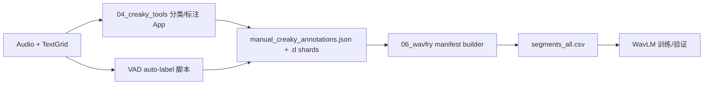

# WavFry 扩展音素返修实施计划 v1.2（审查合并版）

> 日期：2026-07-26  
> 适用项目：`04_creaky_tools`（标注 App、TextGrid、标注存储）与 `06_wavfry`（manifest、训练、推理）  
> 来源：合并 `implementation_plan_rework.md` v1.1、补充 Agent 的 8 项审查意见，以及对当前代码与数据目录的快速核验。  
> 阶段一范围：**只处理英语 EN；自动标注清阻音与经 RMS 检验的空白静音区间。响音只提供推理建议与人工复核，浊阻音和普通话留到阶段二。**

---

## 1. 审查结论

补充 Agent 提出的 8 个问题全部成立，应在实施前并入计划。原计划中“`manifest.py` 完全不动”和“`manual_annotation.py` 只增加一个汇总函数”需要撤回：为了保证 UNKNOWN 永不进入训练、兼容当前分片标注存储并迁移旧空标签 ID，这两个模块都需要小而明确的改动。

| 编号 | 结论 | 当前证据 | 合并后的处理 |
|---|---|---|---|
| Bug 1：空标签与 `SP` ID 不一致 | **成立，阻断性** | `make_interval_id()` 和 App 的 TextGrid 右键标注都直接使用原始空标签；VAD 计划却写 `...\|SP`。当前标注库中已存在 1 条 `...\|`、0 条 `...\|SP` | 建立唯一的 ID 规范化函数，所有 App、VAD、缓存和标注读写共同调用；增加旧 ID 迁移 |
| Bug 2：未知音素 fallback 到 VOWEL | **成立，阻断性** | 原计划伪代码明确 `return IntervalType.VOWEL` | 增加 `UNKNOWN`；调用方按“每个未知标签一次或汇总计数”告警；UNKNOWN 不可标注、不推理、不入 manifest |
| 问题 3：ZH 处理边界 | **成立** | 8 个 anchor speaker 在 EN 目录有 515 个 TextGrid，在 ZH 目录有 809 个；英语 inventory 套到 ZH 后会产生大量 UNKNOWN | VAD 增加 `--lang`，阶段一默认且只允许写入 `en`；ZH 仅允许 dry-run/inventory 报告 |
| 问题 4：30 ms 提前过滤 | **成立，但属于数据卫生** | manifest 已在 `wavfry/data/manifest.py` 中过滤 `< min_duration_ms`；当前默认值为 30 ms | VAD 在写入前也过滤，并报告跳过数量；manifest 保留最终防线 |
| 问题 5：类别不平衡 | **成立且已被数据支持** | anchor 当前二分类标注为 1,984 creaky / 7,296 non-creaky，正类约 21.4%；候选新增的 `>=30 ms` 清阻音约 4,840、空白静音约 3,300，正类预计降到约 11–12% | 重训前生成新 manifest 统计；保留 0.75 基线并比较 0.80/0.85/0.90，不预先硬编码最终值 |
| 问题 6：App 加载路径需重构 | **成立** | `analyze_single_file()` 只把 `is_vowel_label()` 为真的区间放入 `AnalysisResult.vowel_intervals/detections`；表格也只读取 `result.detections` | 新增 typed interval 数据层；UI 过滤发生在分类之后；表格增加 `phone_type` |
| 问题 7：VAD 统计报告 | **成立** | 原计划只在开放问题 Q3 中笼统提到统计，没有固定 schema | 同时输出人类可读 summary 与可选 JSON 报告，包含分位数、跳过、UNKNOWN 和写入冲突 |
| 问题 8：响音阈值与警示 | **成立** | App 当前 `_display_is_creaky()` 对所有检测只使用一个显示阈值 | 元音默认 0.50，响音建议默认 0.65；UI 常驻“仅供参考，需人工确认”；建议结果不自动写入标注 |

### 1.1 审查中额外发现、必须并入的约束

1. **尾部空字段本身并不会让 Python 的 `split("|")` 不稳定。** `"start|end|".split("|")` 会稳定得到 3 段。真正的问题是跨模块 ID 不一致，而不是 split 行为。
2. **分类用的小写标签与 ID 用的 `SP` 必须分离。** 现有 `normalize_phone_label()` 会转成小写；原计划用“已归一化标签”与大写 `"SP"` 比较会漏判。分类检查 `sp`，持久化 ID 使用大写 `SP`。
3. **当前标注库是分片 JSON v2。** `manual_creaky_annotations.json` 只是 manifest，实际数据位于 `manual_creaky_annotations.json.d/`。VAD 不得直接覆写单体 JSON，必须复用 `load_annotations()` / `set_annotation()` / `save_annotations()`。
4. **`get_extended_summary(data, file_key)` 无法只凭标注 JSON 算出 total。** 未标注区间根本不在 JSON 中；total 必须来自当前 TextGrid 的 typed interval inventory。
5. **UNKNOWN 仅靠 App 隐藏不能保证不入训练。** 当前 manifest 会接收任何状态为 `creaky/non_creaky` 的 ID，因此 manifest 必须增加类型验证与允许类型白名单。
6. **App 当前可在展示出来的任意 tier 上右键写标注。** 扩展后必须限制为选定的 phone tier，并拒绝 UNKNOWN，避免把 word tier 文本写入训练标注。
7. **目录配置存在现实差异。** 配置写的是 `12_zh_hfa_aligned`，当前磁盘目录是 `12_zh_mfa_aligned`；阶段一 EN 不受影响，但启用 ZH 前必须修正或显式传入目录。
8. **原计划把清阻音集合写成“21 个”，集合字面量实际为 27 个。** 实施与统计以集合内容和 corpus inventory census 为准，不依赖手写数量。

---

## 2. 当前项目与数据链



职责边界应明确为：

- TextGrid 是区间边界、原始 phone label 和 tier 的权威来源。
- 标注存储是 `creaky/non_creaky/uncertain` 状态的权威来源。
- canonical interval ID 是两者的稳定连接键。
- manifest 是训练快照，不是真值来源；它负责最后的语言、类型、状态和时长过滤。

### 2.1 当前 anchor 数据快照（用于实施后的 sanity check）

本次快速扫描的是 8 个 anchor speaker，数字会随语料变化，实施时应重新计算：

| EN phone 类型 | 全部区间 | `>=30 ms` |
|---|---:|---:|
| VOWEL | 10,652 | 10,083 |
| VOICELESS_OBS | 5,133 | 4,840 |
| SILENCE（TextGrid 空标签） | 3,381 | 3,300 |
| SONORANT | 5,671 | 5,325 |
| VOICED_OBS | 3,150 | 2,952 |
| UNKNOWN（当前为 `spn`） | 111 | 111 |

英语集合对当前 EN inventory 的覆盖良好，唯一未决高频之外标签为 `spn`；它不应 fallback 为 VOWEL，也不应在没有策略前自动当作纯静音。

---

## 3. 已确定的阶段范围

### 阶段一：本计划实施

- EN 元音：维持现有人工标注和推理流程。
- EN 清阻音：`>=30 ms` 时自动写 `non_creaky`。
- EN TextGrid 空标签：canonical ID 使用 `SP`；RMS 低于阈值写 `non_creaky`，否则写 `uncertain`。
- EN 响音：App 可运行 WavFry 推理建议，默认展示阈值 0.65；必须人工确认；阶段一 manifest 默认排除。
- EN 浊阻音：可分类、可按开关显示，但不自动标注、不进入阶段一训练。
- UNKNOWN：汇总告警，不显示在扩展标注表，不允许标注，不推理，不训练。
- ZH/CN：只做 inventory dry-run；不写标注、不训练。

### 阶段二：不在本次实现范围

- 补全并验证普通话 HFA/MFA phone inventory。
- 决定 `spn`、噪声、呼吸声等非语音 token 的独立类型与训练策略。
- 评估响音、浊阻音人工标注是否足以进入训练。
- 评估是否需要独立的 phone-type-aware 模型或采样策略。

---

## 4. 核心数据模型与 ID 规范

### 4.1 轻量共享模块与 `IntervalType`

新增轻量模块 `04_creaky_tools/src/phone_inventory.py`，只依赖 Python 标准库，集中放置 normalize、phone inventory、`IntervalType`、分类与 canonical ID helper。`creaky_vowel_analysis_core.py` 从该模块导入并按需 re-export 现有名称。

不能让 `manual_annotation.py` 或 WavFry manifest 为了分类而导入完整 `creaky_vowel_analysis_core.py`：后者会连带加载 librosa 等 App/音频依赖，而当前 WavFry 环境不保证具备这些依赖。

在轻量模块中增加：

```python
class IntervalType(str, Enum):
    VOWEL = "vowel"
    VOICELESS_OBS = "voiceless_obs"
    SILENCE = "silence"
    SONORANT = "sonorant"
    VOICED_OBS = "voiced_obs"
    UNKNOWN = "unknown"
```

公开分类 API 接受 **raw label**，在函数内部统一归一化，避免调用方忘记 normalize：

```python
def classify_phone_label(raw_phone: str, inventory: PhoneInventory) -> IntervalType:
    id_phone = canonical_phone_for_id(raw_phone)
    if id_phone == "SP":
        return IntervalType.SILENCE

    normalized = normalize_phone_label(raw_phone)
    if normalized in inventory.vowels:
        return IntervalType.VOWEL
    if normalized in inventory.voiceless_obstruents:
        return IntervalType.VOICELESS_OBS
    if normalized in inventory.sonorants:
        return IntervalType.SONORANT
    if normalized in inventory.voiced_obstruents:
        return IntervalType.VOICED_OBS
    return IntervalType.UNKNOWN
```

不要在此热路径对每个区间直接 `logging.warning()`；调用方收集 `Counter`，按唯一标签和次数输出，避免 ZH 文件产生数万行日志。

### 4.2 canonical interval ID

在 `04_creaky_tools/src/phone_inventory.py` 提供唯一实现，App、VAD 和现有 WavFry cache ID 构造都复用；`manual_annotation.py` 导入并 re-export `make_interval_id`，维持现有调用方兼容：

```python
def canonical_phone_for_id(raw_phone: str) -> str:
    raw = str(raw_phone)
    if raw.strip() == "" or normalize_phone_label(raw) == "sp":
        return "SP"
    return raw


def make_interval_id(start: float, end: float, raw_phone: str) -> str:
    phone = canonical_phone_for_id(raw_phone)
    return f"{float(start):.4f}|{float(end):.4f}|{phone}"
```

规则：

- 空字符串、纯空白和字面 `sp/SP` 都持久化为大写 `SP`。
- 其他非空标签保持现有原始文本，不全面 lower-case，避免破坏历史元音 ID 和推理缓存。
- 分类可使用 normalized label；ID 不使用 normalized label（`SP` 特例除外）。
- 移除散落在 core/App 中的 `f"{start:.4f}|..."` 手写逻辑，统一调用 helper。

### 4.3 旧空标签 ID 迁移

增加一次性、可测试的迁移：

- 扫描 `len(interval_id.split("|")) == 3 and phone == ""`。
- 目标改为同边界的 `...|SP`。
- 目标不存在：移动原状态。
- 两者状态相同：保留 `SP`，删除 legacy key。
- 两者状态冲突：不静默覆盖，写入冲突报告并要求人工处理。
- 保存前创建时间戳备份或依赖现有原子写入；先 dry-run 报告迁移数。
- 当前数据快照预期迁移 1 条：`F_23_Sichuan_EN_ZH-CN_U1001_S0_363 / 6.8000|6.9300| / uncertain`。

---

## 5. 模块 A：英语 phone inventory 与 typed intervals

### 5.1 inventory

保留原计划的英语 MFA 集合，但完成以下校验：

- VOWEL：现有英语元音集合。
- SONORANT：鼻音、流音、滑音集合。
- VOICED_OBS：浊塞音、浊擦音集合。
- VOICELESS_OBS：原计划集合字面量（实际 27 个 token）。
- SILENCE：raw empty 或 canonical `SP`。
- `spn` 暂为 UNKNOWN，不自动并入 SILENCE。

阶段一的完整 EN inventory 固定如下，使本文档可以独立实施而不依赖旧计划：

```python
MFA_VOWEL_PHONEMES = {
    "a", "aj", "aw", "aː",
    "e", "ej", "eː",
    "i", "iː",
    "o", "ow", "oː",
    "u", "uː",
    "æ", "ɐ", "ɑ", "ɑː",
    "ɒ", "ɒː", "ɔ", "ɔj",
    "ə", "əw", "ɚ",
    "ɛ", "ɛː", "ɜ", "ɜː", "ɝ",
    "ɪ", "ʉ", "ʉː", "ʊ",
}

MFA_SONORANT_PHONEMES = {
    "m", "mʲ", "m̩", "n", "ŋ", "ɲ",
    "l", "ɫ", "ɹ", "ɾ", "ʎ",
    "j", "w", "ʋ",
}

MFA_VOICED_OBS_PHONEMES = {
    "b", "bʲ", "d", "dʒ", "dʲ", "d̪", "ɖ", "ɟ", "ɟʷ", "ɡ", "ɡʷ",
    "v", "vʲ", "z", "ð", "ʒ",
}

MFA_VOICELESS_OBS_PHONEMES = {
    "c", "cʰ", "cʷ",
    "k", "kp", "kʰ", "kʷ",
    "p", "pʰ", "pʲ", "pʷ",
    "t", "tʃ", "tʰ", "tʲ", "tʷ", "t̪",
    "ʈ", "ʈʲ", "ʈʷ",
    "ç", "f", "fʲ", "h", "s", "ʃ", "θ",
}
```

启动 VAD/App 数据加载时输出 inventory coverage：已分类区间数、UNKNOWN 数量、UNKNOWN top labels。EN pilot 若出现除已知 `spn` 外的新 UNKNOWN，先更新或解释 inventory，再批量写入。

### 5.2 typed interval 数据层

新增轻量数据结构，例如：

```python
@dataclass
class TypedInterval:
    start: float
    end: float
    raw_label: str
    interval_id: str
    phone_type: IntervalType
```

重构 `analyze_single_file()`：

1. 解析完整 phone tier。
2. 为每个 phone interval 生成 `TypedInterval`。
3. 现有 vowel 检测继续只处理 VOWEL，保证数值回归不变。
4. `AnalysisResult` 同时返回完整的 `typed_intervals` 与现有 `detections`。
5. 响音按用户操作单独提交 ONNX 推理，不把它们冒充 vowel detection。

这样可避免给清阻音/SP 填造假的 F0 指标；App 展示层通过 interval ID 将 typed interval、人工状态和可选推理结果连接起来。

---

## 6. 模块 B：VAD 自动标注脚本

新增 `04_creaky_tools/scripts/run_vad_auto_label.py`。

### 6.1 CLI

建议参数：

```text
--lang {en,zh}              默认 en；阶段一只有 en 可以实际写入
--speakers ...              默认 8 个 anchor speaker
--audio-dir PATH            可覆盖语言默认目录
--textgrid-dir PATH         可覆盖语言默认目录
--tier phones
--rms-threshold 0.008
--min-duration-ms 30
--include-voiceless
--dry-run
--report-json PATH          可选机器可读报告
```

语言行为：

- `--lang en`：允许 dry-run 和实际写入。
- `--lang zh`：阶段一只允许 inventory/dry-run；若请求写入则明确失败，直到 ZH inventory 被批准。
- 路径不存在、audio/TextGrid 配对失败、tier 不存在时在写入前失败或汇总为错误，不允许静默跑空。

### 6.2 处理流程

对每个符合语言和 speaker 过滤的文件：

1. 读取 phone tier 并分类所有区间。
2. 对所有自动标注候选先应用 `min_duration_ms`；短区间不写入，计入 `skipped_too_short`。
3. VOICELESS_OBS：候选状态为 `non_creaky`。
4. SILENCE：只对 TextGrid 空标签/`SP` 目标区间截取原始音频段；音频转 mono、float `[-1, 1]`，不加 context padding，计算 `sqrt(mean(x**2))`。
5. `RMS < threshold`：候选状态 `non_creaky`；否则 `uncertain`。
6. UNKNOWN、SONORANT、VOICED_OBS：阶段一不自动写入。
7. 调用统一的 `make_interval_id()`，空标签得到 `...|SP`。
8. 加载现有分片 annotation store；任何已有有效状态默认都不覆盖，分别统计 `skipped_existing`。
9. 只通过 `set_annotation()` 和 `save_annotations(file_keys=dirty_keys)` 保存脏 shard；不得直接 dump 主 JSON。
10. 重复运行应幂等：第二次相同参数运行写入数应为 0。

零采样区间、NaN RMS、音频范围越界不得被当作安静，应记错误或 `uncertain`。

### 6.3 固定统计输出

stdout 至少输出：

```text
=== VAD Auto-label Summary ===
Language: en
Files matched / processed / failed: 515 / 515 / 0
SP intervals found: ...
  -> non-creaky (RMS < 0.008): ... (...%)
  -> uncertain (RMS >= 0.008): ... (...%)
Voiceless cons candidates / written: ... / ...
Skipped < 30 ms: ...
Skipped existing annotations: ...
Unknown intervals: ...; top labels: spn=...
RMS distribution: p25=..., p50=..., p75=..., p90=...
Annotation shards changed: ...
```

JSON 报告保存同样字段，另含参数、运行时间、失败文件列表和 ID 冲突列表。p75 用于判断 0.008 是否合理，p90 帮助观察高能量尾部。

---

## 7. 模块 C：App 显式重构

文件：`04_creaky_tools/app/creaky_vowel_analysis_app.py`。

### 7.1 数据加载与过滤

- App 先加载整个 phone tier，调用 `classify_phone_label()` 生成 typed intervals。
- “显示区间类型”勾选框只控制展示，不控制数据解析：VOWEL、VOICELESS_OBS、SILENCE 默认开启；SONORANT、VOICED_OBS 默认关闭。
- UNKNOWN 不出现在扩展标注/推理表中，只在状态栏显示数量和 top labels。
- word tier 可保留为只读上下文；只有当前 phone tier 的非 UNKNOWN interval 可以写标注。
- TextGrid rectangle、检测表、右键标注、标注同步全部通过 canonical interval ID 查找状态。

### 7.2 表格与列索引

- 当前 detection table 增加 `phone_type` 列。
- 非元音行没有的 F0/WavFry 指标显示 `—`，不要填 0 造成误解。
- 现有代码硬编码了 annotation/play 列索引（例如 11、12）；增加列前先改为列常量或 enum，避免按钮和高亮错列。
- 表格行模型以 `TypedInterval` 为主，并按 interval ID 可选关联现有 `DetectionRow` 或 sonorant suggestion。

### 7.3 颜色与操作

| 类型/状态 | 建议颜色 | 行为 |
|---|---|---|
| VOWEL | 保留现有方案 | 人工状态与现有推理 |
| VOICELESS_OBS | 灰色 | 可批量补标 `non_creaky`，已有状态跳过 |
| SILENCE + non_creaky | 深灰 | 已确认安静 |
| SILENCE + uncertain | 黄色 | 进入逐条播放核查队列 |
| SONORANT / VOICED_OBS | 绿色系 | 仅建议与人工确认 |

批量按钮：

- “清辅音 → non-creaky”：只处理当前文件 VOICELESS_OBS，幂等，不覆盖已有状态。
- “SP uncertain → 播放核查”：按顺序选择并播放，沿用 C/N/? 或现有状态循环快捷方式。
- “响音 → 跑推理”：只产生 suggestion，不自动写 `manual_creaky_annotations`。

### 7.4 响音推理阈值

- VOWEL：沿用当前可调显示阈值，默认 0.50。
- SONORANT：独立阈值，默认 0.65。
- UI 常驻文本：`⚠ 响音推理仅供参考，必须人工确认`。
- 推理建议应与人工 annotation state 分开存放/显示；人工状态始终优先。
- VOICED_OBS 阶段一不启用推理按钮。

### 7.5 返修进度

原计划的 `get_extended_summary(data, file_key)` 改为接受 TextGrid inventory，例如：

```python
get_extended_summary(data, file_key, typed_intervals)
```

`total` 来自 typed intervals；`annotated/uncertain` 通过 canonical ID 查询 annotation store。不得通过“JSON 中出现了多少 ID”推断总区间数。

---

## 8. 模块 D：manifest 的最小安全改动

文件：`06_wavfry/wavfry/data/manifest.py`。

保留现有行为：

- 只接受 `creaky/non_creaky`，跳过 `uncertain`。
- 保留 `min_duration_ms` 最终过滤。
- 从现有 annotation store 生成训练记录。

增加以下安全层：

1. 从轻量 `04_creaky_tools.src.phone_inventory` 导入分类 API，根据 file language 选择相应 inventory，并分类 `phone`；不得导入完整 App core。
2. UNKNOWN 永远跳过并计数告警。
3. 新增配置 `data.training_phone_types`；阶段一默认：

   ```yaml
   data:
     training_phone_types: [vowel, voiceless_obs, silence]
     include_languages: [en]
   ```

4. SONORANT、VOICED_OBS 即使已有人工状态，阶段一也只有在显式加入白名单后才进训练。
5. 输出 manifest 统计：按 language、phone_type、label、speaker、annotation_type 计数，以及 creaky 正类比例。
6. CSV 增加 `phone_type` 列；现有 Dataset 允许忽略额外列，无需改变音频读取接口。
7. 构建前校验所需目录存在；ZH 路径配置问题在启用 ZH 前解决。

这使“标注状态单一真值来源”仍成立，同时防止错误或历史 UNKNOWN 标注绕过 App 进入训练。

---

## 9. 模块 E：类别比例与重训决策

当前 anchor 二分类标注快照：

- creaky：1,984
- non-creaky：7,296
- uncertain：928（不训练）
- 当前训练候选中的 creaky 比例：`1,984 / (1,984 + 7,296) ≈ 21.4%`

若 `>=30 ms` 的 4,840 个清阻音和大部分 3,300 个 SP 成为负例，正类比例预计约 11–12%。因此：

1. 全量自动标注完成后重新构建 manifest。
2. 将整体和每个 speaker/split 的正负样本数写入报告。
3. 保留 `focal_alpha=0.75` 作为可比基线。
4. 至少比较 `0.80 / 0.85 / 0.90`；按 validation AUC-PR、F1、precision/recall 与 speaker-level 稳定性选择，不按训练准确率选择。
5. 若 0.90 recall 上升但 precision 明显恶化，不因“更接近反频率”就采用；最终值写入实验配置和报告。
6. 新增自动负例后仍按 speaker 划分，严禁同一 speaker 泄漏到 train/validation。

---

## 10. 实施顺序

1. **先锁定 ID 与测试**
   - 添加 canonical ID helper、UNKNOWN enum 和单元测试。
   - 替换 App/core/cache 中手写 ID。
   - dry-run 并迁移旧 `...|` ID。
2. **实现 inventory 与 typed intervals**
   - 完成 EN corpus census 和 UNKNOWN 汇总。
   - 保证现有 VOWEL detection 输出数值不变。
3. **实现 VAD 脚本**
   - 先 `--lang en --speakers U1001 --dry-run`。
   - 检查 RMS 分布和 0.008 阈值。
4. **完成 U1001 小规模写入与 App 联调**
   - 验证 `...|SP` 能被 App 读取。
   - 验证分片保存、幂等和已有人工标注保护。
5. **重构 App UI**
   - typed interval 表格、过滤器、颜色、批量操作、响音建议阈值、进度统计。
6. **增加 manifest 安全过滤与统计**
   - UNKNOWN/类型/语言白名单。
   - 保留 uncertain 和 30 ms 过滤。
7. **8 speaker 全量 EN dry-run → 写入 → 人工复核 uncertain SP**
8. **构建新 manifest，决定 focal_alpha，进行重训与回归评估**

任何一步未通过验收，不进入下一步的大规模写入或训练。

---

## 11. 测试与验收标准

### 11.1 单元测试

- `make_interval_id(0.91, 1.02, "") == "0.9100|1.0200|SP"`。
- `make_interval_id(..., "sp")` 与 `"SP"` 产生同一 ID。
- 非空元音 ID 与当前格式完全一致。
- raw empty / `SP` 分类为 SILENCE；分类内部大小写一致。
- 未知英语标签和普通话示例不再 fallback 为 VOWEL，而是 UNKNOWN。
- `<30 ms` 自动候选不写入；恰好 30 ms 的边界行为有测试。
- VAD 第二次同参数运行写入数为 0。
- 已有 `creaky/non_creaky/uncertain` 均不被自动覆盖。
- 分片 store 保存后仍能由现有 `load_annotations()` 完整读取。
- 旧空 ID 迁移的无冲突、同状态和冲突三条路径都有测试。

### 11.2 App 集成验收

- U1001 的 VAD `SP` 标注在 App 中按相同区间显示，不再出现“JSON 有、App 查不到”。
- 类型勾选框只改变展示，不丢失底层 inventory。
- 表格存在 `phone_type`，非适用指标显示 `—`。
- UNKNOWN 和 word tier 不能被写入 annotation store。
- 响音使用 0.65 默认阈值并显示警告；建议不自动写状态。
- SP uncertain 可连续播放并人工改成 C/N/?。
- 原有元音标注、推理、播放和表格高亮行为回归通过。

### 11.3 VAD/manifest 验收

- U1001 dry-run 报告包含完整固定字段和 RMS p25/p50/p75/p90。
- 全量 EN 文件数与 speaker 过滤结果可解释；失败文件明确列出。
- VAD 写入前后 annotation 数量差等于报告中的 written 数。
- manifest 中不存在 uncertain、UNKNOWN、`<30 ms` 或非白名单 phone type。
- manifest 汇总计数与 VAD/App 汇总能按排除规则对账。
- 新 manifest 明确输出正类比例，再决定 focal_alpha。

---

## 12. 安全、回滚与产物

- 第一次实际写入前，备份主 annotation manifest 与 `.d` shard 目录，并记录时间戳。
- 所有大规模操作先 dry-run；先 U1001，再 8 speaker。
- 自动脚本默认不覆盖任何已有状态；冲突只报告。
- 每次全量运行保存：CLI 参数、summary、JSON report、annotation 备份路径、manifest 统计和 git revision（如可用）。
- 回滚时恢复成套的主 manifest 与 `.d`，不能只恢复主 JSON。

预期新增/修改产物：

```text
04_creaky_tools/
  scripts/run_vad_auto_label.py
  src/phone_inventory.py
  src/creaky_vowel_analysis_core.py
  src/manual_annotation.py
  app/creaky_vowel_analysis_app.py
  tests/...                         # ID、分类、迁移、VAD、App helper

06_wavfry/
  wavfry/data/manifest.py
  config/_defaults.yaml             # include_languages/training_phone_types
  docs/...                          # 本计划与后续运行报告
```

---

## 13. 实施前只保留三个数据决策门

1. **RMS 阈值门**：以 U1001 的分布、uncertain 比例和人工抽听决定是否保留 0.008。
2. **全量写入门**：U1001 的 ID 对齐、分片保存、App 复核和幂等测试全部通过后，才处理 8 speaker。
3. **训练超参数门**：新 manifest 的实测类别比例与验证实验完成后，才确定 focal_alpha。

阶段一的功能范围本身不再开放：EN 清阻音 + SP 自动标注；响音仅建议/人工复核；浊阻音和 ZH 延后。
