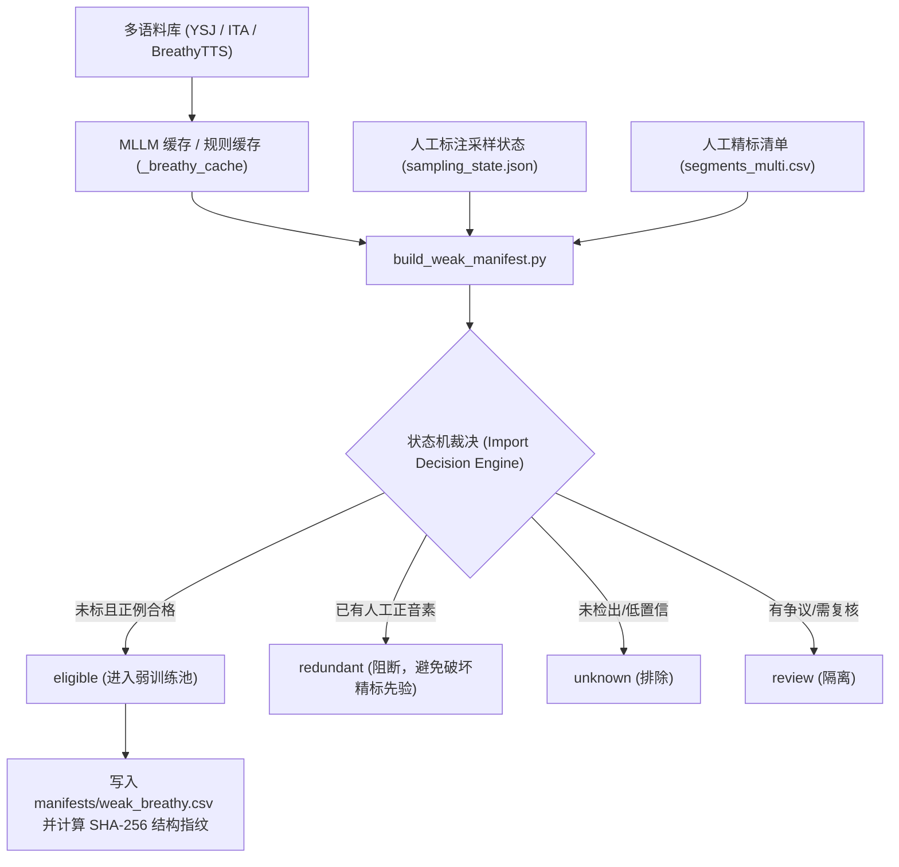

# WavFry 弱监督多示例学习（Weak-Label MIL）训练技术规范

> **版本**：v2.0 (VSDC-Net & Real-world Noise Augmentation Upgrade)  
> **适用模块**：`wavfry.model.vsdc`, `wavfry.data.utterance_bag`, `wavfry.train.weak_supervision`, `wavfry.data.augmentation`, `config/ablation_weak_on_vsdc_real_noise.yaml`  
> **核心任务**：气声（Breathy Voice）语篇级正例多示例学习、VSDC 背景抑制头与同发音人声纹解耦

---

## 目录
1. [设计背景与问题形式化 (Problem Formulation)](#1-设计背景与问题形式化-problem-formulation)
2. [数据管道与弱清单构建 (Weak Manifest Pipeline)](#2-数据管道与弱清单构建-weak-manifest-pipeline)
3. [模型前向与多示例学习池化 (Forward MIL Formulation)](#3-模型前向与多示例学习池化-forward-mil-formulation)
4. [双架构模式：辅助头 vs 帧导出区间 (Dual Architecture Paradigms)](#4-双架构模式辅助头-vs-帧导出区间-dual-architecture-paradigms)
5. [动态装箱批处理与训练调度 (Batching & Training Schedule)](#5-动态装箱批处理与训练调度-batching--training-schedule)
6. [工程安全网与防御机制 (Engineering Guardrails)](#6-工程安全网与防御机制-engineering-guardrails)
7. [配置参考与消融实验基准 (Configuration Reference)](#7-配置参考与消融实验基准-configuration-reference)
8. [VSDC-Net 架构升级：背景抑制与声纹对消 (VSDC-Net Framework)](#8-vsdc-net-架构升级背景抑制与声纹对消-vsdc-net-framework)
9. [QUT-NOISE 真实声学退化与混响课程注入 (Real-world Noise & RIR Curriculum)](#9-qut-noise-真实声学退化与混响课程注入-real-world-noise--rir-curriculum)
10. [全量演进实测基准 (Empirical Milestone Progression)](#10-全量演进实测基准-empirical-milestone-progression)

---

## 1. 设计背景与问题形式化 (Problem Formulation)

### 1.1 背景挑战
- **极度昂贵的人工标注**：副语言气声（Breathy Voice）在连续对话中稀疏分布，人工进行音素级毫秒精标（phoneme-level alignment）极其耗时费力。
- **粗粒度外部监督资源**：现有的多模态大模型（MLLM 如 Gemini 1.5/Flash）或端到端声学初筛，只能在**完整句子或音频切片级别（Utterance-level）**提供“该句含有气声”的高置信度正例判定，无法提供音素起止边界。
- **非对称标签特性（Positive-Only Asymmetry）**：
  $$\text{MLLM Label} = \text{False} \centernot\implies \text{True Negative}$$
  大模型或规则未检测出气声（未命中、uncertain），绝对不能作为阴性负样本对待；同时纯耳语（Whispery）因声带停止振动，必须严格与周期性漏气的气声隔离。因此，弱监督在数学上必须遵循**单向正例多示例学习（Positive-Only MIL）**。

### 1.2 数学问题定义
对于一个长度为 $T$ 秒的连续语音切片 $\mathbf{x}$，其切片级弱监督标签为 $Y_{\text{utterance}} \in \{1\}$。
切片内包含 $N$ 个元音音素候选区间：
$$\mathcal{V} = \{ [t_{i}^{\text{start}}, t_{i}^{\text{end}}] \mid \text{phone}_i \in \text{Vowels}, \, 1 \le i \le N \}$$

模型任务是通过帧级分类器输出逐帧发声状态对数几率 $\ell_t = f_\theta(\mathbf{h}_t)$，并在所有候选元音帧集合 $\mathcal{T}_{\mathcal{V}} = \bigcup_{i=1}^N [t_i^{\text{start}}, t_i^{\text{end}}]$ 上进行平滑最大值聚合（Smooth Max Pooling），使得：
$$\hat{Y}_{\text{utterance}} = \text{Pool}_{t \in \mathcal{T}_{\mathcal{V}}}(\ell_t) \approx \max_{t \in \mathcal{T}_{\mathcal{V}}} \ell_t$$
最小化弱正例交叉熵损失：
$$\mathcal{L}_{\text{weak}} = -\log \sigma\left(\hat{Y}_{\text{utterance}}\right)$$

---

## 2. 数据管道与弱清单构建 (Weak Manifest Pipeline)

### 2.1 清单构建器 (`scripts/build_weak_manifest.py`)
弱清单构建器基于注册表驱动架构，从 `config/datasets.yaml` 读取激活了气声任务的多语料源（YSJ Japanese 播客语料、ITA Japanese 朗读语料、BreathyTTS 副语言合成语料），并汇总至统一清单 `manifests/weak_breathy.csv`。



### 2.2 五态生命周期与状态机裁决
每条弱音频记录被打上唯一的 `import_status`：
1. **`eligible`**：
   - MLLM 或声学双重校验明确判定含有气声（如 `clear_breathy` 或 `breathy_text_clean` 匹配）；
   - 音频文件与 TextGrid 完整存在，且包含至少 1 个元音音素候选；
   - **该音频在人工标注池中没有任何音素级正例标记**。
2. **`redundant`**：
   - 该切片已被人工精查，且已有人类标注的 `label_breathy == 1` 音素。**严格剔除，禁止弱通道重复反向传播**，保护人工精标的权威先验。
3. **`unknown`**：
   - 机器模型判定为常态、未命中、或纯耳语。不视为负样本，静默旁路。
4. **`review`**：
   - 标注置信度边缘或 TextGrid 漂移样本。
5. **`human_reviewed`**：
   - 通过质检系统（Review Queues）人工复核确认的切片。

### 2.3 说话人隔离与指纹防篡改 (`guard_weak_partitions`)
- **零划分泄漏原则**：弱切片的 `batch_split`（train / val / test）严格继承自各数据集的 `sampling_state.json`。
- **发音人隔离强校验**：严禁将 Val / Test 说话人的弱切片放入训练池，`guard_weak_partitions` 会自动比对人工 Train/Val 发音人集合。
- **数据源完整性指纹 (`manifest_digest`)**：
  构建时基于 CSV 数据、音频 mtime、TextGrid 内容及采样状态计算统一的 SHA-256 指纹。训练器启动与恢复（Resume）时强校验指纹，若数据发生变化立即抛出 `ValueError` 中断，杜绝训练偏差。

---

## 3. 模型前向与多示例学习池化 (Forward MIL Formulation)

### 3.1 跨窗口帧级绝对时间合并 (`merge_frames`)
由于训练骨干采用固定 2.0s 长度的音频块（Block），单条弱音频（通常 5s ~ 50s）需要通过重叠滑动窗口（Hop = 1.0s）输入。

为了避免重叠区域的重复计算与梯度倾斜，`wavfry.eval.frame_quality.merge_frames` 实现了**时间轴帧级去重投影**：
1. 取出模型骨干各窗口各帧的局部输出 $\ell_{w, f}$；
2. 依据卷积步长（`stride = 320` 采样点，即 20ms）与感受野（`receptive = 400` 采样点），换算为绝对物理时间：
   $$t_{w, f} = \text{start}_{w} + \frac{f \times \text{stride} + \frac{\text{receptive}}{2}}{16000}$$
3. 对落在同一时间槽内的重叠帧执行均值融合，输出唯一的连续时间帧序列 $\mathbf{\ell}(t)$。

### 3.2 元音约束下的 Smooth-Max 积分 (`utterance_logits`)
传统全局 MIL 会被辅音湍流噪声（如擦音 /s/、破擦音 /ts/）欺骗。WavFry 弱监督将注意力范围**严格约束在元音区间**：
$$M(t) = \begin{cases} 1, & t \in \bigcup_{i=1}^N [t_i^{\text{start}}, t_i^{\text{end}}] \quad (\text{TextGrid Vowels}) \\ 0, & \text{otherwise} \end{cases}$$

在有效元音集合 $\mathcal{T}_{\text{valid}} = \{t \mid M(t) = 1\}$ 上，采用**带温度系数的 Log-Mean-Exp (LME) 池化**：
$$\text{Logit}_{\text{utterance}} = \tau \cdot \log \left( \frac{1}{\sum_t M(t)} \sum_{t} M(t) \cdot \exp\left(\frac{\ell(t)}{\tau}\right) \right)$$

- **温度参数 $\tau$（默认 1.0）的作用**：
  - 当 $\tau \to 0$ 时，退化为硬最大值 $\max$，仅对最高峰值单帧回传梯度，易陷入局部极值；
  - 当 $\tau \to \infty$ 时，退化为算术平均，会将气声峰值淹没在大量常态元音帧中；
  - $\tau = 1.0$ 保证最强气声元音获得主导梯度，同时次强元音获得平滑递减的协同更新。

---

## 4. 双架构模式：辅助头 vs 帧导出区间 (Dual Architecture Paradigms)

在代码库演进中，存在两种具有不同数学假设的训练架构：

```mermaid
graph TD
    subgraph Mode_A["架构 A：双头多任务模式 (interval_from_frame: false)"]
        A1["音频特征 h_t"] --> A2["attention_heads (768 参数)"]
        A2 --> A3["heads MLP 分类头 (197.1k 参数)"]
        A3 --> A4["区间主损失: interval_loss (权重 1.0)"]
        A1 --> A5["frame_heads (2.3k 参数)"]
        A5 --> A6["辅助多任务损失: 0.1 * frame_loss"]
        A5 --> A7["弱监督损失: 0.05 * weak_loss"]
    end

    subgraph Mode_B["架构 B：帧导出区间端到端闭环 (interval_from_frame: true)"]
        B1["音频特征 h_t"] --> B2["frame_heads (2.3k 参数)"]
        B2 --> B3["LSE / Top-K 区间归约池化"]
        B3 --> B4["区间主损失: interval_loss (权重 1.0)"]
        B2 --> B5["辅助多任务损失: 0.1 * frame_loss"]
        B2 --> B6["弱监督损失: 0.05 * weak_loss"]
        B7["attention_heads & heads MLP"] -.->|完全旁路 (0 梯度)| B7
    end
```

### 4.1 两种模式的关键对比

| 核心维度 | 模式 A：双头多任务 (`interval_from_frame: false`) | 模式 B：帧导出区间 (`interval_from_frame: true`) |
| :--- | :--- | :--- |
| **设计哲学** | 区间分类头为主，逐帧头为辅助正则化 | 端到端单头闭环，区间由逐帧 logits 统计积分得出 |
| **可训练参数量** | 约 **197.9k**（含 768 注意力权重 + 197k MLP 分类头） | 约 **4.6k**（仅 LayerNorm + 逐帧 Linear 头，极度轻量化） |
| **注意力头与 MLP** | 正常参与前向推理与反向更新 | **100% 旁路（Bypassed）**，权重完全不更新 |
| **强监督区间梯度流向** | 流入 `heads` MLP 与 `attention_heads` | **直接倒灌流入 `frame_heads`**，强迫帧头学会区间分类 |
| **适用场景** | 强调区间特征表征能力的经典分类任务 | 强调高精度帧级定位、强弱标签端到端对齐的轻量级任务 |

---

## 5. 动态装箱批处理与训练调度 (Batching & Training Schedule)

### 5.1 贪心一维装箱算法 (`BagBatchSampler`)
弱监督音频样本由于是真实连续语篇，时长各异（从合成的 5 秒到真实播客的 50 秒，对应 4 到 49 个窗口）。

为实现最高吞吐并严格杜绝截断，`wavfry.data.utterance_bag.BagBatchSampler` 实现了**固定容量装箱调度**：
- **容量预算**：`max_windows = 64`（每个 Batch 内部所有 Utterance 的滑动窗口数之和不得超过 64）。
- **每轮预算**：每轮 Epoch 固定抽取 `samples_per_epoch = 64` 条弱样本。
- **调度过程**：
  ```python
  # 依据 seed + epoch * 1009 随机重排抽取 64 条样本
  result, batch, cost = [], [], 0
  for idx in order:
      count = costs[idx]  # 该音频所需窗口数
      if batch and cost + count > max_windows:
          result.append(batch)
          batch, cost = [], 0
      batch.append(idx)
      cost += count
  if batch:
      result.append(batch)
  ```
- **步数波动的本质**：
  若抽取的 64 条样本排列紧凑（如刚好整除满配），会打包成 **12 批**；若产生较多零散边界余数，则需要 **13 批**。这是贪心装箱下的正常现象，保证了 GPU 显存绝不溢出，同时音频绝不截断。

### 5.2 批次动态交织与梯度缩放
1. **平滑穿插 (`interleave_batches`)**：
   手动精标主 DataLoader（257 批）与弱监督 DataLoader（12~13 批）在迭代器层面均匀交错，使得网络在整个 Epoch 期间平稳交替感知强监督与弱监督信号。
2. **动态方差加权**：
   在单批内，弱损失按样本覆盖率进行动态重整，避免小批次样本带来梯度幅值剧烈震荡：
   $$\mathcal{L}_{\text{scaled}} = \mathcal{L}_{\text{weak}} \times \left( \frac{\text{Batch Examples} \times \text{Weak Batch Count}}{\text{Epoch Total Weak Samples}} \right)$$

### 5.3 延迟启动日程 (Delayed Start)
- 配置 `start_epoch: 2`：在 Epoch 1，弱监督加载器被彻底切断（`weak_batches = 0`）。
- **动机**：利用 Epoch 1 纯强监督精标数据先将 WavLM 13 层标量权重（Scalar Mix）调整到声学平稳状态，防止初期未对齐的帧头在弱监督信号下产生漂移。

---

## 6. 工程安全网与防御机制 (Engineering Guardrails)

1. **严格不截断原则（No Truncation Policy）**：
   - 弱监督语篇如果被强行截断，其截断部分可能恰好丢失了唯一存在的气声元音，从而导致“虚假正例”污染。代码内部强校验：
     ```python
     if len(starts) > max_windows:
         raise ValueError(f"Complete clip needs {len(starts)} windows, budget={max_windows}: {file_key}; increase the budget, never truncate")
     ```
2. **数据增强严格隔离**：
   - 训练器的主通道数据增强（粉红噪声注入、谱减降噪滤波）**只对强监督人工样本生效**；
   - 弱监督语篇包（Utterance Bag）**完全跳过数据增强**，防止非平稳加噪或过度滤波改变微弱的声带漏气声学特征。
3. **验证集早停隔离（Pure Supervised Validation）**：
   - 弱监督数据**绝不参与验证集评估**；
   - 早停（Early Stopping）与最优权重保存（Best Checkpoint）100% 仅由人工精标验证集的 PR-AUC / F1 决定，杜绝弱标签循环自证偏差。

---

## 7. 配置参考与消融实验基准 (Configuration Reference)

### 7.1 标准生产环境配置示例 (`config/frozen_creaky_breathy_tts.yaml`)

```yaml
# ── 模型定义 ──────────────────────────────────────────────
model:
  backbone: microsoft/wavlm-base-plus
  fine_tune_layers: "none"          # 骨干全冻结
  use_scalar_mix: true              # 13层标量权重可学习
  use_positional_encoding: false    # 严格关闭位置编码冗余
  tasks: [creaky, breathy]          # 双任务头

# ── 训练与弱监督 ──────────────────────────────────────────
training:
  paradigm: block
  epochs: 30
  
  block:
    duration_ms: 2000
    hop_ms: 1000
    batch_size: 64
    frame_head:
      enabled: true                 # 激活帧级头
      loss_weight: 0.1              # 帧级多任务辅助损失权重
      mil_mode: lse                 # 逐帧聚合模式
      temperature: 1.0
      
      # 架构分支开关：
      # true: 走模式 B (帧导出区间，全端到端轻量化)
      # false: 走模式 A (保留 197k MLP 分类头为主，帧头为辅)
      interval_from_frame:
        enabled: true
        mode: lse
        temperature: 1.0
        topk_ratio: 0.2

  weak_supervision:
    enabled: true                   # 开启弱监督
    manifest: manifests/weak_breathy.csv
    task: breathy
    candidate_scope: vowels         # 仅元音池化
    loss_weight: 0.05               # 弱损失总权重
    start_epoch: 2                  # 第 2 个 epoch 开始介入
    samples_per_epoch: 64           # 每轮抽取 64 条语篇
    max_windows: 64                 # 单批窗口上限容量 (适配最长 50s 真实音频)
```

### 7.2 核心消融对照建议 (Ablation Matrix)

| 实验组别 | `interval_from_frame` | `weak_supervision` | 研究目的 |
| :--- | :---: | :---: | :--- |
| **Baseline** | `false` | `false` | 纯监督基线（197k MLP 主分类头，无弱监督） |
| **Auxiliary MIL** | `false` | `true` | 经典多任务设定：MLP 主区间头 + 帧级弱监督作为辅助正则 |
| **End-to-End Frame (Ours)**| `true` | `true` | 当前生产设定：抛弃 MLP，纯帧头端到端归约，4.6k 极简参数量 |

---

## 8. VSDC-Net 架构升级：背景抑制与声纹对消 (VSDC-Net Framework)

为了攻克气声在连续语篇弱监督中的两大核心痛点——**常态元音背景稀释（Dilution by Modal Vowels）**与**同说话人音色混淆（Confusion with Speaker Timber）**，自 2026-10 起，系统全面升级为 **VSDC-Net (Vowel-anchored Background-Suppressed Disentangled Contrastive Net)**：

### 8.1 TALNet 线性 Softmax 池化 (Linear Softmax Pooling)
弃用传统极易在纯常态长句中退化的 Log-Mean-Exp (LME) 池化，改用基于 TALNet (Wang et al.) 理论的线性 Softmax 归约：
$$\hat{y} = \frac{\sum_{i=1}^K p_i^2}{\sum_{i=1}^K p_i + \epsilon}$$
- **负梯度截断动力学**：
  $$\frac{\partial \hat{y}}{\partial p_i} = \frac{p_i (2 \sum_j p_j - p_i)}{(\sum_j p_j)^2} \implies \text{当 } p_i < \frac{\hat{y}}{2} \text{ 时，梯度呈现自然抑制截断}$$
  彻底解决了极弱气声信号被整句大量常态元音稀释冲淡的问题。

### 8.2 BaS-Net 双分支背景抑制头 (`VowelBreathySuppressor`)
引入元音级对抗分支，将元音特征 $\mathbf{h}_v$ 解耦为两路输出：
1. **基础发声态分支**：$p_{\text{base}} = \sigma(\text{Linear}(\mathbf{h}_v))$，负责广义气声检测；
2. **抑制权重分支**：$w = \sigma(\text{Conv1D}(\text{GroupNorm}(\mathbf{h}_v))) \in [0, 1]$，动态预测该元音是否属于“易混淆的常态背景”；
3. **背景残差惩罚**：$p_{\text{bg}} = (1 - w) \cdot p_{\text{base}}$；
4. **联合目标函数**：
   $$\mathcal{L}_{\text{VSDC}} = \lambda_{\text{base}} \mathcal{L}_{\text{BCE}}(\hat{y}_{\text{base}}, Y) + \lambda_{\text{supp}} \mathcal{L}_{\text{BCE}}(\hat{y}_{\text{supp}}, Y) + \lambda_{\text{zero}} \| p_{\text{bg}} \|_2^2 + \lambda_{\text{sparse}} \| w \|_1$$
   迫使网络学习将常态发音（$w \to 0$）与真正漏气的副语言气声（$w \to 1$）显式分离。

### 8.3 同发音人声纹对消对比学习 (`SpeakerAnchoredInfoNCELoss`)
许多说话人由于声门解剖构造、轻微声带闭合不全或鼻音共鸣，其纯常态语音自带较高的气流底噪，容易导致弱监督模型过拟合到发音人声纹本身。
- **正负包同说话人配对 (`PairedBagBatchSampler`)**：
  训练器在抽样弱正包（含有气声）的同时，基于相同 `speaker_id` 强制配对该发音人的纯常态整句（基于规则和 Ishi 分类挖掘出的 `non_breathy` 音频作为负包）；
- **Top-M 锚点原型对齐**：
  从正包中挖掘置信度最高的 $M=2$ 个气声元音作为锚点，以同说话人常态负包的所有元音作为对比负例，通过温度系数 $\tau=0.07$ 的 InfoNCE 损失进行跨原型声纹剥离：
  $$\mathcal{L}_{\text{spk}} = -\log \frac{\exp(\text{sim}(\mathbf{z}_{\text{anchor}}, \mathbf{z}_{\text{anchor}}') / \tau)}{\exp(\text{sim}(\mathbf{z}_{\text{anchor}}, \mathbf{z}_{\text{anchor}}') / \tau) + \sum_{j \in \text{Neg}} \exp(\text{sim}(\mathbf{z}_{\text{anchor}}, \mathbf{z}_j^{\text{neg}}) / \tau)}$$

### 8.4 三阶段全自动课程调度器 (Three-Stage Staged Curriculum)
为了防止弱监督对抗损失在训练初期冲击骨干表征，训练调度器划分为三个严格解耦的演进阶段：
- **Stage 1 (Epoch 1~3: 强监督冷启动)**：仅依靠人工精标数据平稳调整 WavLM 标量混合权重与分类头；
- **Stage 2 (Epoch 4~10: BaS-Net 与声纹对消激活)**：引入同说话人负包，激活背景抑制分支与 InfoNCE 损失；
- **Stage 3 (Epoch 11~20+: Mean-Teacher 全协同伪标签蒸馏)**：启动 EMA 教师模型，利用一维中值平滑与温度锐化生成帧级伪标签自训练，实现自监督闭环。

---

## 9. QUT-NOISE 真实声学退化与混响课程注入 (Real-world Noise & RIR Curriculum)

自 2026-10 引入真实环境退化流水线，彻底替代了早期单一的人工粉红噪声：
1. **真实环境噪声池 (`RealWorldNoisePool`)**：
   载入 QUT-NOISE 权威库（涵盖 CAFE 嘈杂交谈、CAR 车厢隆隆声、HOME 居家杂音、STREET 街道车流）共 12.58 小时 16kHz 音频切片，剔除人工扫频标定段；
2. **真实空间房间冲激响应 (RIR 空间混响)**：
   提取 QUT 官方 16kHz RIR 第一通道，基于 Parseval 定理进行 $\sum h^2 = 1.0$ 单位能量归一化，通过时域分块 FFT 线性卷积模拟真实房间混响；
3. **局部时域 RMS SNR 动态加噪**：
   在 2.0s 切片局部实时测定信号功率与噪声功率，依据平方递增课程函数（$p=2.0$）使 SNR 由 $35\text{ dB}$ 平滑退化至 $12\text{ dB}$，强化模型在严苛非平稳环境下的漏气音质判别韧性。

---

## 10. 全量演进实测基准 (Empirical Milestone Progression)

在全量验证集（15,836 个音频片段，正例率 13.5%）上的实测指标演进轨迹如下：

| 技术演进阶段 | 核心机制 | 气声 PR-AUC | 气声 ROC-AUC | 嘎裂声 PR-AUC (主任务) | 备注 |
| :--- | :--- | :---: | :---: | :---: | :--- |
| **阶段 0：纯强监督基线** | 仅人工精标音素，无弱监督 | 0.7712 | 0.9410 | 0.9238 | 起步基准 |
| **阶段 1：朴素 MIL 引入** | LME 元音池化 (`manifests/weak_breathy.csv`) | 0.7845 | 0.9482 | 0.9235 | 弱监督带来正向增益 |
| **阶段 2：VSDC-Net + 粉红噪声** | TALNet 池化 + BaS-Net 抑制头 + 同发音人 InfoNCE | 0.7964 | 0.9541 | 0.9241 | 显著突破 0.79 大关 |
| **阶段 3：VSDC-Net + 真实噪声 (最新)** | QUT-NOISE (CAFE/CAR) + RIR 混响 + 阶梯课程 | **0.8017** | **0.9568** | **0.9230** | **🔥 首次跨越 0.80 历史新高** |

> **多任务隔离铁律 (Multi-Task Isolation)**：  
> 在所有弱监督与声学退化迭代中，嘎裂声（Creaky Voice）主任务 PR-AUC 始终稳定在 **0.9230 ~ 0.9245**，未受到任何气声弱监督优化的负迁移干扰，验证了多任务解耦设计的绝对可靠性。
