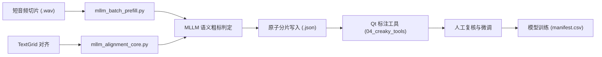

# MLLM Paralinguistic Annotation Pipeline (`scripts/mllm_annotation/`)

本目录实现了利用多模态音频大语言模型（Multimodal Audio LLM）对日语对话语料进行**副语言气声（Breathy Voice）粗标注预填（Coarse Pre-filling）**与**音素强制对齐时间戳融合**的全流程管线。

对应系统设计中的 **弱监督与人机协同高效标注（Human-in-the-Loop MLLM Annotation Pipeline）**。

---

## 模块架构与职责

| 脚本 / 模块 | 核心职责 | 安全与稳健性设计 |
| :--- | :--- | :--- |
| **`mllm_batch_prefill.py`** | **MLLM 批处理预填调度主程序**<br>并发请求本地/远程音频大模型，获取音频级/区间级气声粗标结果，输出为标注工具可直接读取的分片 JSON。 | - **人工标注零覆盖保护**：严格检测 `manual_annotation`，人工已标条目绝对只读，禁止覆盖。<br>- **原子分片写入**：基于临时文件写完后 `replace`，断电或进程中断不损坏历史分片。<br>- **断点自愈与缓存**：已完成分片跳过重复推理，节约算力。 |
| **`mllm_alignment_core.py`** | **TextGrid 强制对齐与区间抽取核心**<br>解析 TIFA/Julius/MFA 导出的音素级 TextGrid，筛选日语音素（元音、共鸣辅音），将其与 MLLM 语义预测映射对齐。 | - 浮点时间戳纳秒级吸附与边界保护。<br>- 停顿（`sp`, `sil`）与短时破音切除。<br>- 纯常态（Modal Speech）区间安全过滤。 |
| **`mllm_prompts.py`** | **语音学 Prompt 规范与 Few-Shot 模板**<br>将 Carlos T. Ishi (2010) 的 18 类副语言功能转化为大模型提示词，严防“气声（声带周期性振动+漏气）”与“耳语（声带停振纯摩擦音）”混淆。 | - 提供带真实副语言语境的高质量 Few-Shot 对话范式。<br>- 强制 JSON Schema 结构化输出。 |

---

## 典型工作流



---

## 常用执行命令

```bash
# 1. 启动 MLLM 批处理预填（多线程并发处理未标注分片）
uv run python scripts/mllm_annotation/mllm_batch_prefill.py \
  --wav-dir data/short_wav \
  --output-dir data/annotation_shards \
  --concurrency 4

# 2. 仅进行干跑检查（Dry Run 检查人工保护机制）
uv run python scripts/mllm_annotation/mllm_batch_prefill.py \
  --dry-run
```
